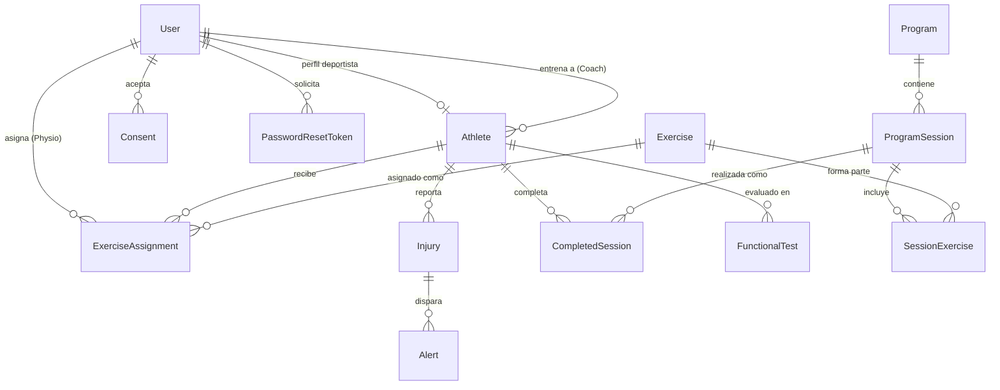

# LuchaSegura · Contexto Maestro Actualizado

> **Propósito:** Documento de referencia arquitectónica, técnica y funcional del proyecto **LuchaSegura**. Representa la fuente de verdad consolidada a partir de la auditoría de código fuente, esquema de base de datos, estado de Git y contrastación con el documento académico original.  
> **Fecha de corte de auditoría:** Noviembre de 2026.  
> **Rama de trabajo activa:** `develop` (actualizada con `origin/develop`).  

---

## 1. Resumen Ejecutivo y Propósito del Proyecto

**LuchaSegura** es una aplicación web y progresiva (PWA en preparación) concebida para la **prevención de lesiones músculo-esqueléticas en deportistas de lucha libre olímpica**. 

El software surge en el marco de la investigación formativa de la carrera de Fisioterapia de la **Universidad del Rosario** en articulación con el **Instituto Distrital de Recreación y Deporte (IDRD)** de Bogotá, Colombia.

### Metodología y Enfoque
- **Intervención:** Programa preventivo estructurado de **ocho (8) semanas**, con una frecuencia de **3 sesiones semanales** y una duración estimada de **20 a 30 minutos por sesión**.
- **Población diana:** Luchadores de la selección Bogotá (IDRD), con edades comprendidas entre los **13 y los 25 años** (género mixto).
- **Componentes de ejercicio:** Movilidad dinámica, Estabilidad articular/core, Fuerza muscular y Pliometría, y Técnica/desplazamientos de lucha.
- **Seguimiento continuo:** Detección y registro de molestias físicas, control de adherencia al programa, y asignación de ejercicios correctivos individualizados.
- **Límite ético y legal explícito:** La aplicación es una herramienta de soporte y orientación pedagógica; **bajo ninguna circunstancia reemplaza la valoración clínica ni la prescripción médica o fisioterapéutica presencial**.

---

## 2. Contexto Institucional y Académico

### Ficha Técnica de la Investigación
- **Proyecto:** *Proyecto Deporte de Lucha Libre Olímpica*.
- **Instituciones:** Universidad del Rosario – IDRD Bogotá.
- **Investigadores / Autores:** Nicolás Cruz, Naishla Martínez y Andrés López.
- **Población deportiva:** Atletas de estilo libre y grecorromano, categorías cadetes, juveniles y mayores (13 a 25 años). Dado que incluye menores de edad entre 13 y 17 años, está sujeta a la Ley Estatutaria 1581 de 2012 de Colombia sobre protección de datos personales de menores y datos sensibles de salud.

### Fundamentos Científicos del Proyecto
1. **Epidemiología en Lucha:** Basado en registros de la NCAA (9.6 lesiones por cada 1000 exposiciones) y del sistema de vigilancia de la United World Wrestling (UWW) y el Comité Olímpico Internacional (COI). Las regiones anatómicas más vulnerables son:
   - Rodilla (25% a 40% de las lesiones; alta vulnerabilidad del ligamento cruzado anterior [LCA] por desbalances cuádriceps/isquiotibiales).
   - Cabeza, cuello, columna vertebral y tronco (24.5% a 48%).
   - Miembros superiores (hombro, codo, muñeca: 9.3% a 42%).
   - Miembros inferiores (tobillo y pie: 7.5% a 15%).
2. **Protocolos de Referencia:**
   - **Wrestling+** (Bayati et al., 2025): 14 ejercicios en 3 fases, redujo la incidencia lesional en un 58% y la carga total de lesiones en 63%.
   - **FIFA 11+ Modificado para Lucha** (Eskandari et al., 2025): 8 semanas, 3 sesiones/semana, mejoras significativas en fuerza concéntrica y excéntrica de isquiotibiales y control de valgo dinámico.
   - **SMR y Movilidad Torácica** (Kim, 2026): Liberación miofascial y movilidad escapulotorácica con bandas para mitigar dolor lumbar y de hombro.

---

## 3. Arquitectura del Software

El sistema sigue una arquitectura desacoplada cliente-servidor mediante una API RESTful sin estado (*stateless*) y una base de datos relacional.

```
┌────────────────────────────────────────────────────────┐
│                   NAVEGADOR / PWA                     │
│  Angular 20.3 (Standalone Components + Signals + SCSS) │
└───────────────────────────┬────────────────────────────┘
                            │ HTTPS / JSON (JWT Bearer)
                            ▼
┌────────────────────────────────────────────────────────┐
│                   BACKEND API                          │
│  Node.js 22 LTS + Express 4.21 + TypeScript 5.9       │
│  Middlewares: Auth (JWT), Rate-Limit, Helmet, Cors     │
└───────────────────────────┬────────────────────────────┘
                            │ Prisma ORM 6.19
                            ▼
┌────────────────────────────────────────────────────────┐
│                 BASE DE DATOS RELACIONAL               │
│  PostgreSQL 16 en puerto 5432                          │
└────────────────────────────────────────────────────────┘
```

### Principios Arquitectónicos Implementados
- **Frontend Standalone Puro:** Angular sin `NgModule`, basado exclusivamente en Signals reactivos (`signal`, `computed`), `inject()` funcional, y control flow moderno (`@if`, `@for`, `@switch`).
- **Gráficos SVG Nativos:** Gráficas de líneas (`LineChart`), barras (`BarChart`) y cumplimiento circular (`ProgressRing`) creadas con SVG reactivo nativo y `ResizeObserver` sin librerías externas pesadas como Chart.js.
- **Validación Estricta:** Uso intensivo de esquemas **Zod** en todas las rutas de backend y **ReactiveFormsModule** en frontend.
- **Seguridad en Capas:** Control de acceso basado en roles (RBAC) tanto en guards de Angular como en middlewares de Express.

---

## 4. Stack Tecnológico y Versiones Confirmadas

### Frontend
- **Framework:** Angular `^20.3.0` (Standalone components, Zoneless-ready con Zone.js `~0.15.0`).
- **Build System:** `@angular/build` `^20.3.42` (Vite dev server + esbuild bundler).
- **Enrutamiento:** `@angular/router` `^20.3.0` con carga diferida (`loadComponent`).
- **Estilos:** SCSS nativo con tokens CSS variables para modo claro y oscuro (`styles.scss`).
- **Iconografía y Alertas:** SVG inline y componentes propios (`Icon`, `DelBtn`, `Logo`); diálogos con `sweetalert2` `^11.26.25`.
- **TypeScript:** `~5.9.2`.

### Backend
- **Entorno:** Node.js `>=20` (ejecutado sobre Linux CachyOS).
- **Framework Web:** Express `^4.21.2` con `express-async-errors` `^3.1.1`.
- **Ejecución en Desarrollo:** `tsx` `^4.19.2` (TypeScript Execute con recarga en caliente).
- **ORM:** Prisma Client y Prisma CLI `^6.19.0` (instalado `6.19.3`).
- **Validación:** Zod `^3.24.1`.
- **Autenticación:** `jsonwebtoken` `^9.0.2` (HS256) y `bcryptjs` `^2.4.3`.
- **Seguridad y Rate Limiting:** `helmet` `^8.0.0`, `cors` `^2.8.5`, `express-rate-limit` `^7.5.1`.
- **Generación de Archivos:** `exceljs` `^4.4.0`.
- **TypeScript:** `^5.9.3`.

### Base de Datos
- **Motor:** PostgreSQL 16.
- **Configuración:** Conexión vía pool TCP (`DATABASE_URL`).
- **Migraciones:** 4 migraciones versionadas en `backend/prisma/migrations/`.

---

## 5. Estructura Real de Carpetas

```
luchasegura/
├── backend/
│   ├── prisma/
│   │   ├── migrations/               # Historial de 4 migraciones SQL aplicadas
│   │   ├── clean-demo.ts             # Script para purgar usuarios @demo.local
│   │   ├── create-admin.ts           # Creación interactiva de usuario administrador
│   │   ├── schema.prisma             # Definición de modelos, enums e índices
│   │   ├── seed-program.ts           # Siembra del programa preventivo de 8 semanas
│   │   ├── seed-team.ts              # Siembra de atletas y molestias demo
│   │   └── seed.ts                   # Semilla inicial (usuarios base)
│   ├── src/
│   │   ├── middleware/
│   │   │   ├── auth.ts               # requireAuth (valida JWT, revocación) y requireRole
│   │   │   └── limits.ts             # Limitadores de fuerza bruta (login, registro, recovery)
│   │   ├── routes/
│   │   │   ├── admin.ts              # /api/admin: usuarios y asignación de deportistas
│   │   │   ├── athletes.ts           # /api/athletes: perfil y listado de deportistas
│   │   │   ├── auth.ts               # /api/auth: login, registro, recuperación, me
│   │   │   ├── exercises.ts          # /api/exercises: biblioteca y asignaciones individuales
│   │   │   ├── health.ts             # /api/health: verificación de estado y DB
│   │   │   ├── injuries.ts           # /api/injuries: reporte y antecedentes
│   │   │   ├── program.ts            # /api/program: consulta y completado de sesiones
│   │   │   ├── rules.ts              # /api/rules: umbrales de alerta (fisioterapia)
│   │   │   └── team.ts               # /api/team: resumen, alertas, ficha, exportar Excel
│   │   ├── app.ts                    # Configuración de Express, middlewares globales y rutas
│   │   ├── config.ts                 # Variables de entorno tipadas y centralizadas
│   │   ├── db.ts                     # Instancia Singleton de PrismaClient
│   │   └── index.ts                  # Punto de entrada y app.listen()
│   ├── package.json
│   └── tsconfig.json
├── frontend/
│   ├── public/
│   │   ├── icons/                    # Iconos PWA (apple-touch, 192, 512, maskable)
│   │   ├── favicon.svg               # Favicon vectorial con degradado
│   │   ├── logo-mark.svg             # Símbolo oficial de LuchaSegura
│   │   └── manifest.webmanifest      # Manifiesto PWA
│   ├── src/
│   │   ├── app/
│   │   │   ├── admin/                # Módulo Administrador (usuarios y asignaciones)
│   │   │   ├── athlete/              # Módulo Deportista (home, plan, reportar, progreso, perfil)
│   │   │   ├── core/                 # Servicios, stores, componentes transversales y utilidades
│   │   │   ├── pages/                # Pantallas públicas (login, registro, recuperación)
│   │   │   ├── team/                 # Módulo Entrenador / Fisioterapeuta (overview, atletas, ficha, ejercicios, umbrales)
│   │   │   ├── app.config.ts         # Configuración de proveedores (HttpClient con interceptor)
│   │   │   ├── app.routes.ts         # Rutas protegidas por Guards
│   │   │   └── app.ts                # Componente raíz
│   │   ├── index.html                # HTML base con definiciones SVG globales
│   │   ├── main.ts                   # Bootstrap de la aplicación Angular
│   │   └── styles.scss               # Sistema de diseño, temas y utilidades
│   ├── angular.json
│   ├── package.json
│   └── tsconfig.app.json
└── docs/                             # Documentación técnica e institucional
```

---

## 6. Modelo de Roles y Permisos (RBAC)

La plataforma maneja cuatro roles mutuamente excluyentes definidos en el enum `Role`:

| Rol | Alcance y Propósito | Acceso en Frontend | Endpoints Backend |
| :--- | :--- | :--- | :--- |
| **`ATHLETE`** | Deportistas de lucha olímpica. Registran molestias, consultan su programa, completan sesiones, revisan progreso y configuran su perfil. | `/deportista/*` | `/api/athletes/me`, `/api/injuries/*`, `/api/program/*`, `/api/exercises/mine` |
| **`COACH`** | Entrenador. Supervisa la adherencia y estado lesional **únicamente de los deportistas asignados a su tutela**. Consulta la biblioteca de ejercicios (solo lectura). | `/equipo/*` (excepto gestión de umbrales y creación de ejercicios) | `/api/team/*` (filtrado por `coachId`), `/api/exercises` (GET) |
| **`PHYSIO`** | Fisioterapeuta del equipo. Supervisa a **todos** los deportistas, define umbrales de alerta, administra la biblioteca de ejercicios, asigna ejercicios específicos y exporta datos a Excel. | `/equipo/*` (acceso completo) | `/api/team/*`, `/api/rules/*`, `/api/exercises/*` (CRUD y asignación) |
| **`ADMIN`** | Administrador del sistema. Crea cuentas institucionales (COACH, PHYSIO, ADMIN), activa/desactiva cuentas, asigna deportistas a entrenadores y purga usuarios. | `/admin/*` | `/api/admin/*` |

---

## 7. Catálogo de Endpoints de la API

### Autenticación y Cuentas (`/api/auth`)
- `POST /register`: Registro autónomo de deportistas con fecha de nacimiento y consentimiento informado. *(Nota de auditoría: contiene código duplicado que requiere limpieza)*.
- `POST /login`: Autenticación con correo y contraseña. Retorna JWT y usuario con control de intentos fallidos.
- `GET /me`: Obtiene los datos del usuario en sesión (`requireAuth`).
- `POST /change-password`: Cambio de contraseña (obligatorio tras restablecimiento o contraseña temporal).
- `POST /forgot-password`: Genera token de restablecimiento con vigencia de 30 minutos.
- `GET /reset-password/check`: Verifica si un token de recuperación sigue vigente.
- `POST /reset-password`: Aplica la nueva contraseña mediante el token de recuperación.

### Deportistas (`/api/athletes`)
- `GET /me`: Retorna la ficha de perfil del deportista autenticado.
- `PUT /me`: Actualiza peso, categoría, estilo, experiencia y observaciones.
- `GET /`: Lista de deportistas (para entrenador filtrada por asignación, para fisio global).

### Molestias y Antecedentes (`/api/injuries`)
- `POST /`: Crea un reporte de molestia o antecedente. Si la molestia supera el umbral configurado, crea una `Alert` automática.
- `GET /mine`: Historial de reportes del deportista en sesión.
- `DELETE /:id`: Eliminación de antecedentes en cualquier momento; reportes de molestia solo dentro de las primeras 24 horas.

### Programa Preventivo (`/api/program`)
- `GET /current`: Devuelve el programa de 8 semanas, la semana actual calculada y el estado de las sesiones.
- `POST /sessions/:id/toggle`: Alterna el estado completado/pendiente de una sesión para el deportista.

### Fisioterapia y Equipo (`/api/team`)
- `GET /overview`: Métricas generales (cumplimiento promedio, alertas nuevas, baja adherencia) y listado.
- `POST /alerts/:id/review`: Marca una alerta médica como revisada.
- `GET /athletes/:id`: Ficha clínica integral del deportista (datos, gráficas, antecedentes, molestias).
- `GET /export`: Descarga libro Excel con hojas de Deportistas, Molestias y Sesiones (admite `?anon=1`).

### Biblioteca y Asignación de Ejercicios (`/api/exercises`)
- `GET /`: Catálogo completo de ejercicios (Movilidad, Estabilidad, Fuerza, Técnica).
- `POST /`: Crea un nuevo ejercicio (solo PHYSIO).
- `PATCH /:id`: Actualiza datos y enlace multimedia de un ejercicio (solo PHYSIO).
- `DELETE /:id`: Archiva el ejercicio si tiene dependencias o lo elimina físicamente si está libre.
- `GET /mine`: Ejercicios individualizados asignados al deportista en sesión.
- `GET /athlete/:athleteId`: Ejercicios asignados a un deportista específico.
- `POST /assignments`: Asigna un ejercicio de la biblioteca a un deportista con dosificación y nota.
- `DELETE /assignments/:id`: Revoca la asignación individual.

### Reglas y Umbrales (`/api/rules`)
- `GET /`: Lista de umbrales de dolor configurados por zona o globales.
- `POST /`: Crea o actualiza un umbral de dolor (solo PHYSIO).
- `DELETE /:id`: Elimina un umbral configurado.

### Administración (`/api/admin`)
- `GET /users`: Listado de todos los usuarios registrados.
- `POST /users`: Alta de usuarios del cuerpo técnico/admin con contraseña temporal.
- `PATCH /users/:id`: Activa o desactiva el acceso de una cuenta.
- `PATCH /athletes/:id/coach`: Asigna o remueve el entrenador a cargo de un deportista.
- `DELETE /users/:id`: Eliminación física de una cuenta con borrado en cascada.

---

## 8. Esquema de Base de Datos y Relaciones

El modelo se define en [backend/prisma/schema.prisma](file:///home/snuuzz/Proyectos/luchasegura/backend/prisma/schema.prisma) y consta de 14 entidades relacionales principales:



### Modelos y Propósito
1. **`User`**: Identidad central, credenciales hashed, estado activo y bandera de cambio obligatorio de clave (`mustChangePassword`).
2. **`Athlete`**: Perfil deportivo vinculado 1:1 con `User`. Datos antropométricos y deportivos (peso, estilo, experiencia).
3. **`Consent`**: Trazabilidad del consentimiento informado y nombre del acudiente (`guardianName`).
4. **`Injury`**: Registro de molestias activas o antecedentes históricos, dolor VAS (0-10), zona, limitación de entrenamiento y mecanismo.
5. **`AlertRule`**: Umbral mínimo de intensidad por zona anatómica (o null para global) que detona una alerta médica.
6. **`Alert`**: Notificación de atención médica generada para el fisioterapeuta con estados `NEW` y `REVIEWED`.
7. **`Program`**: Especificación de la intervención preventiva (8 semanas, 3 sesiones/sem).
8. **`ProgramSession`**: Cada una de las 24 sesiones planificadas (semana 1 a 8, sesión 1 a 3).
9. **`Exercise`**: Ficha del ejercicio (nombre, componente, dosificación, zona y `mediaUrl` a YouTube/Vimeo/imagen).
10. **`ExerciseAssignment`**: Asignación individualizada de un ejercicio a un atleta con indicación personalizada.
11. **`SessionExercise`**: Tabla intermedia que vincula los ejercicios del catálogo a cada sesión del programa base.
12. **`CompletedSession`**: Registro de cumplimiento que guarda qué atleta completó qué sesión y en qué fecha.
13. **`FunctionalTest`**: Entidad de pruebas físicas y funcionales (SEBT/YBT, FMS, T-test). *(Existe en el esquema pero no tiene endpoints ni vistas)*.
14. **`PasswordResetToken`**: Tokens criptográficos efímeros con expiración para el restablecimiento de contraseñas.

---

## 9. Decisiones Técnicas Vigentes

1. **Frontend sin dependencias pesadas de UI:** Se descartó Material UI, Bootstrap o Tailwind. El diseño es 100% SCSS a medida con variables semánticas (`--surf`, `--pri`, `--ink`, `--bad`) y soporte nativo de tema oscuro mediante `[data-theme='dark']`.
2. **Visualización de datos con SVG puro:** No se utilizan librerías de terceros (Chart.js, D3). Las gráficas son componentes SVG ligeros, completamente reactivos a Signals.
3. **Gestión de Sesión:** El token JWT se almacena en `sessionStorage` para limitar su vida útil a la ventana del navegador, mitigando la persistencia pasiva de `localStorage`.
4. **Manejo de Inactividad:** `SessionWatcher` monitoriza eventos de interacción del usuario y cierra la sesión automáticamente tras 15 minutos de inactividad.
5. **Doble factor en eliminaciones:** Las acciones destructivas críticas emplean el componente `DelBtn` (botón con microinteracción animada) y diálogos de confirmación modales accesibles (`confirmDialog`).

---

## 10. Estado Real de Git y Cambios Locales

### Ramas
- `develop`: Rama principal de trabajo. Contiene los 10 commits del desarrollo funcional.
- `main`: Permanece en el commit inicial del esqueleto del proyecto (`e725247`). Las dos ramas presentan una divergencia de 10 commits que se integrarán cuando el ciclo sea validado por el usuario.

### Archivos Modificados Localmente (Unstaged):
- `frontend/src/app/admin/users.page.ts`: Incorporación de `DelBtn` para eliminar usuarios.
- `frontend/src/app/athlete/profile.page.ts`: Incorporación de `DelBtn` para eliminar antecedentes.
- `frontend/src/app/athlete/report.page.ts`: Incorporación de `DelBtn` para eliminar reportes recientes.
- `frontend/src/app/core/icon.ts`: Ajuste del trazo vectorial del icono `trash`.
- `frontend/src/app/team/athlete-detail.page.ts`: Incorporación de `DelBtn` para desasignar ejercicios.
- `frontend/src/app/team/exercises.page.ts`: Incorporación de `DelBtn` para eliminar ejercicios.
- `frontend/src/app/team/rules.page.ts`: Incorporación de `DelBtn` para eliminar umbrales.
- `frontend/src/index.html`: Enlace del favicon apuntando al nuevo recurso PNG 192x192.
- `frontend/src/styles.scss`: Clases `.del`, `.del-t` y ajustes de grilla para botones de acción.

### Archivos Sin Seguimiento (Untracked):
- `frontend/src/app/core/del-btn.ts`: Componente del botón interactivo de borrado.
- `frontend/public/favicon.svg`: Icono vectorial para navegadores modernos.
- `frontend/public/logo-mark.svg`: Símbolo SVG del escudo.
- `frontend/public/icons/`: Conjunto de iconos PNG generados para PWA (192, 512, apple-touch).
- `docs/claude-handoff/`: Paquete de transferencia y auditoría técnica.
