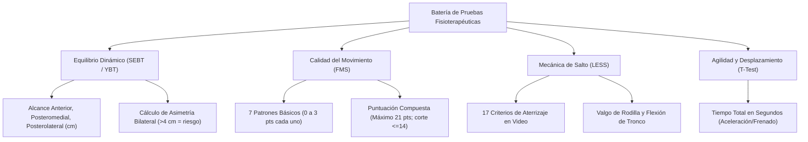

# LuchaSegura · Trazabilidad Académica y Brechas de Investigación

> **Propósito:** Contrastar los objetivos, requerimientos metodológicos y protocolos científicos del documento académico original (*Proyecto Deporte de Lucha Libre Olímpica*, Universidad del Rosario – IDRD) con las capacidades implementadas en el software **LuchaSegura**, identificando brechas críticas para la culminación del proyecto de grado.  
> **Fuente documental primaria:** `PROYECTO DEPORTE DE LUCHA LIBRE OLÍMPICA.pdf` (localizado en `/home/snuuzz/Descargas/`).

---

## 1. Ficha Institucional y Metodológica

| Parámetro | Definición Académica Oficial |
| :--- | :--- |
| **Título del Proyecto** | *Proyecto Deporte de Lucha Libre Olímpica* |
| **Instituciones Aliadas** | Universidad del Rosario (Facultad de Fisioterapia) — Instituto Distrital de Recreación y Deporte (IDRD Bogotá) |
| **Integrantes del Proyecto** | Nicolás Cruz, Naishla Martínez y Andrés López |
| **Población Deportiva** | Luchadores de la Selección Bogotá (IDRD) de lucha olímpica estilo libre y grecorromana |
| **Rango Etario y Género** | Entre 13 y 25 años de edad; género mixto (**incluye deportistas menores de edad entre 13 y 17 años**) |
| **Diseño del Estudio** | Descriptivo longitudinal con intervención preventiva de 8 semanas y seguimiento epidemiológico (modelo NCAA ISP / UWW) |
| **Objetivo General** | Favorecer la prevención de lesiones en luchadores olímpicos a nivel competitivo mediante la integración de hábitos preventivos y fortalecimiento muscular específico. |

---

## 2. Bases Científicas del Protocolo

El protocolo académico estructurado en el documento se sustenta en tres investigaciones de medicina deportiva y fisioterapia de alto impacto:

1. **Protocolo Wrestling+ (Bayati et al., 2025):**
   - Ensayo controlado aleatorizado de la United World Wrestling (UWW) con 80 luchadores.
   - Demostró una **reducción del 58% en la incidencia general de lesiones** y del 63% en la carga total de lesiones (60% rodilla, 71% tobillo, 71% columna, 63% hombro).
   - Generó aumentos significativos en el equilibrio dinámico unipodal y de tren superior medido por Y-Balance Test (**YBT** y **YBT-UQ**), así como mejoras en la prueba **FMS**.
2. **FIFA 11+ Modificado para Lucha (Eskandari et al., 2025):**
   - Protocolo de 8 semanas, 3 sesiones semanales de 20 a 30 minutos en luchadores de élite.
   - Demostró incremento significativo en la fuerza isocinética concéntrica y excéntrica de los músculos flexores y extensores de rodilla (curl nórdico, zancadas, pliometría), corrigiendo el desbalance isquiotibial/cuádriceps que predispone a roturas del ligamento cruzado anterior (LCA).
   - Estructurado en 4 fases: Movilidad dinámica (5 min), Estabilidad/core (6 min), Fuerza/pliometría (10 min) y Desplazamientos técnicos (balance y velocidad).
3. **SMR y Movilidad Torácica (Kim, 2026):**
   - Protocolo de liberación automiofascial con rodillo de espuma (foam roller) y movilidad torácica asistida con bandas elásticas para mitigar dolor lumbar y de hombro en luchadores grecorromanos.
   - Evaluación funcional mediante el Índice de Incapacidad Lumbar de Oswestry (**ODI**) y escala visual analógica (**VAS**).

---

## 3. Matriz de Trazabilidad: Academia vs Software

La siguiente tabla contrasta cada requerimiento emanado del documento académico con su estado real de implementación en el software:

| # | Requerimiento Académico del Proyecto | Componente en Código / BD | Estado en Software | Brecha / Diagnóstico Técnico |
| :---: | :--- | :--- | :---: | :--- |
| **RA-01** | **Intervención preventiva de 8 semanas** (3 sesiones/sem, 20-30 min) | `Program`, `ProgramSession`, `program.ts`, `plan.page.ts` | **Parcial** | La estructura de 8 semanas y 24 sesiones existe, pero la semana actual se calcula con `createdAt` del atleta y el catálogo de ejercicios en BD es solo un borrador semilla. |
| **RA-02** | **Evaluación Inicial (Fase 1 / Semana 0)** | Inexistente en UI / API | **No Implementado** | No hay vista ni formulario para consolidar la batería inicial de pruebas antes de arrancar la intervención. |
| **RA-03** | **Evaluación Final (Fase 3 / Semana 8)** | Inexistente en UI / API | **No Implementado** | No existe interfaz para repetir las pruebas funcionales al terminar las 8 semanas. |
| **RA-04** | **Comparación estadística Pre vs Post** | Inexistente | **No Implementado** | La aplicación no computa ni muestra el delta de mejora funcional o reducción lesional entre Semana 0 y Semana 8. |
| **RA-05** | **Prueba Y-Balance Test (SEBT / YBT / YBT-UQ)** | Modelo `FunctionalTest` (vacío) | **No Implementado** | Solo existe la tabla relacional; no hay campos ni pantallas para registrar distancias de alcance anterior, posteromedial y posterolateral en cm. |
| **RA-06** | **Prueba FMS (Functional Movement Screen)** | Modelo `FunctionalTest` (vacío) | **No Implementado** | No se capturan las puntuaciones (0 a 3) de los 7 patrones fundamentales: sentadilla profunda, paso de valla, zancada, movilidad de hombro, elevación activa de pierna, flexión de tronco y estabilidad rotatoria. |
| **RA-07** | **Prueba LESS (Landing Error Scoring System)** | Modelo `FunctionalTest` (vacío) | **No Implementado** | No hay registro de errores biomecánicos de aterrizaje en salto. |
| **RA-08** | **Prueba Agility T-Test** | Modelo `FunctionalTest` (vacío) | **No Implementado** | No hay registro del tiempo cronometrado de cambio de dirección. |
| **RA-09** | **Escala de Incapacidad Lumbar (ODI)** | Inexistente | **No Implementado** | No está implementado el cuestionario de Oswestry para deportistas con molestias crónicas lumbares. |
| **RA-10** | **Escala de Dolor VAS (Visual Analogue Scale)** | `Injury.intensity`, `report.page.ts` | **Implementado y Probado** | Escala numérica visual de 0 a 10 con colores semánticos y registro de evolución temporal. |
| **RA-11** | **Ficha de Lesiones (NCAA ISP / UWW / COI)** | `Injury`, `report.page.ts`, `profile.page.ts` | **Implementado y Probado** | Captura zona, mecanismo, momento de aparición, días de ausencia deportiva, recurrencia y limitación. |
| **RA-12** | **Encuesta de Prácticas Preventivas Actuales** | Inexistente | **No Implementado** | Requerimiento metodológico formal para conocer qué hábitos tienen los luchadores antes de la intervención. |
| **RA-13** | **Registro de Adherencia Semanal** | `CompletedSession`, `team.ts`, `overview.page.ts` | **Implementado y Probado** | Almacena fecha de completado por sesión y calcula % de cumplimiento general y casos de baja adherencia (<60%). |
| **RA-14** | **Seguimiento Individual del Atleta** | `athlete-detail.page.ts`, `athletes.page.ts` | **Implementado y Probado** | Ficha clínica completa accesible por entrenador y fisioterapeuta con gráficas de evolución. |
| **RA-15** | **Individualización de Ejercicios** | `ExerciseAssignment`, `exercises.ts`, `athlete-detail.page.ts` | **Implementado sin probar** | El fisioterapeuta puede asignar ejercicios correctivos puntuales con notas y dosificación personalizada. |
| **RA-16** | **Hábitos de Recuperación, Fatiga y Sueño** | Inexistente | **No Implementado** | Objetivo específico del proyecto (promover hábitos sobre fatiga y descanso) sin módulo en el software. |
| **RA-17** | **Protección de Datos de Menores (Ley 1581)** | `Consent`, `register.page.ts` | **Parcial** | Captura nombre de acudiente, pero omite tipo y número de documento de identidad del acudiente y no audita descargas en Excel. |

---

## 4. Análisis Detallado de las Pruebas Físico-Funcionales Pendientes

El proyecto académico exige explícitamente cuatro pruebas funcionales estandarizadas que actualmente **no están implementadas en la aplicación**:

### 1. SEBT / Y-Balance Test (YBT y YBT-UQ)
- **Justificación científica en Lucha:** Evalúa asimetrías de miembros inferiores y superiores tras agarres y derribos. Asimetrías > 4 cm en alcance anterior incrementan significativamente el riesgo de esguince de tobillo y rotura de LCA.
- **Variables requeridas:**
  - Longitud de extremidad (cm).
  - Alcances pierna derecha e izquierda: Anterior, Posteromedial, Posterolateral.
  - Puntuación compuesta normalizada: `((Suma de 3 alcances) / (3 * Longitud miembro)) * 100`.

### 2. Functional Movement Screen (FMS)
- **Justificación científica en Lucha:** Identifica déficits neuromusculares y asimetrías compensatorias en la cadena cinética.
- **Variables requeridas:**
  - Puntuación de 0 a 3 en 7 pruebas:
    1. Sentadilla profunda (*Deep Squat*).
    2. Paso de valla (*Hurdle Step*).
    3. Estocada en línea (*In-Line Lunge*).
    4. Movilidad de hombro (*Shoulder Mobility*).
    5. Elevación activa de pierna recta (*Active Straight-Leg Raise*).
    6. Estabilidad de tronco en flexión (*Trunk Stability Push-Up*).
    7. Estabilidad rotatoria (*Rotary Stability*).
  - Puntuación total compuesta (0 a 21 puntos). Puntuación `<= 14` indica riesgo elevado de lesión.

### 3. Landing Error Scoring System (LESS)
- **Variables requeridas:** Evaluación cualitativa de aterrizaje desde cajón de 30 cm (valgo de rodilla al impacto, flexión de cadera y tronco).

### 4. Agility T-Test
- **Variables requeridas:** Tiempo en segundos (precisión a 2 decimales) en recorrido de 40 metros con desplazamientos laterales y retroceso.

---

## 5. Marco Legal Colombiano y Protección de Datos de Menores

La población objeto del IDRD incluye luchadores entre los **13 y los 17 años**, clasificados como menores de edad según la legislación colombiana.

### Normativa Aplicable
- **Ley Estatutaria 1581 de 2012** (Régimen General de Protección de Datos Personales).
- **Decreto 1377 de 2013**, Artículo 12 (Tratamiento de datos personales de niños, niñas y adolescentes).
- **Resolución 8430 de 1993 del Ministerio de Salud** (Normas científicas y éticas para la investigación en salud).

### Requisitos Legales Obligatorios no Cumplidos en el Software Actual
1. **Identificación Plena del Representante Legal:**
   - Actualmente: `schema.prisma` solo guarda `guardianName String?` en `Consent`.
   - Requerimiento legal: Debe capturar obligatoriamente **Tipo de documento** (Cédula de Ciudadanía / Cédula de Extranjería), **Número de documento**, **Parentesco** (Padre, Madre, Tutor Legal) y **Teléfono de contacto**.
2. **Doble Consentimiento / Asentimiento:**
   - En deportistas de 13 a 17 años, se requiere el **Consentimiento Informado del acudiente** y el **Asentimiento Informado del menor de edad**.
3. **Custodia y Auditoría de Datos Sensibles de Salud:**
   - La información de lesiones y diagnósticos físicos es catalogada como dato sensible. Cualquier exportación masiva a Excel debe registrarse en una bitácora inmutable (`AuditLog`) con fecha, usuario solicitante, IP y finalidad académica.

---

## 6. Brechas Críticas que Deben Cerrarse

Para que el software cumpla a cabalidad con la investigación de grado de la Universidad del Rosario, Claude debe priorizar las siguientes adiciones:

1. **Módulo de Pruebas Funcionales:**
   - Crear tablas en Prisma y endpoints para registrar y consultar resultados de FMS, YBT y T-Test.
   - Vista en la ficha del atleta para que el fisioterapeuta ingrese las mediciones de Fase Inicial (Semana 0) y Fase Final (Semana 8).
2. **Desacoplamiento del Calendario de la Intervención:**
   - Permitir al administrador o fisioterapeuta fijar la fecha oficial de inicio de la cohorte del IDRD, en lugar de amarrar la semana a la fecha de registro individual.
3. **Módulo Educativo de Hábitos y Recuperación:**
   - Pantalla o sección con orientaciones pedagógicas sobre recuperación post-combate, manejo del sueño, hidratación y reporte oportuno del dolor.
4. **Fortalecimiento del Consentimiento Legal de Menores:**
   - Actualizar el modelo `Consent` y el formulario de registro para incluir documento de identidad y teléfono del tutor legal.
5. **Reporte Comparativo Final:**
   - Generación de informe comparativo individual y grupal (Pre vs Post) exportable a Excel para el análisis estadístico de la tesis de grado.
