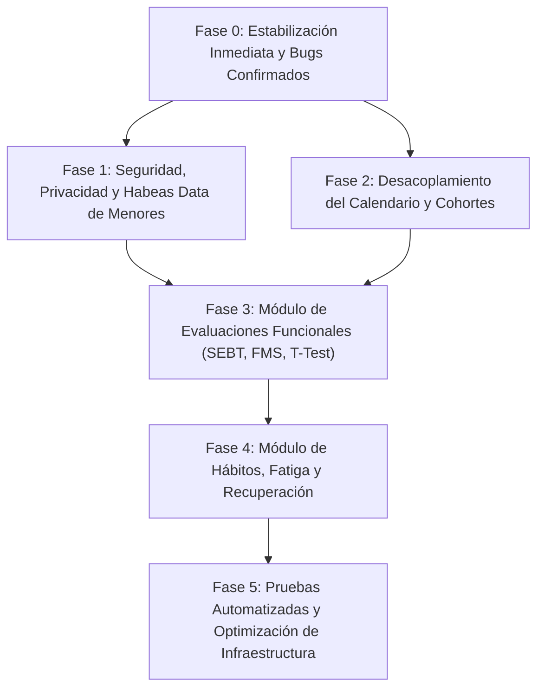

# LuchaSegura · Plan de Desarrollo y Hoja de Ruta Priorizada

> **Propósito:** Hoja de ruta técnica estructurada por fases de ejecución para guiar el desarrollo continuo de **LuchaSegura**.  
> **Filosofía de trabajo:** Preservar la arquitectura existente, no realizar reconstrucciones innecesarias, ejecutar cambios atómicos y basar cada avance en pruebas de aceptación verificables.

---

## 1. Mapa de Fases de Desarrollo



---

## 2. Fase 0: Estabilización Inmediata y Corrección de Bugs Confirmados
> **Objetivo:** Resolver los defectos técnicos detectados en la auditoría que generan inestabilidad o inconsistencias de navegación, sin alterar la estructura de la base de datos.

### Tarea 0.1. Eliminación de Ruta Duplicada en Autenticación
- **Archivo:** [backend/src/routes/auth.ts](file:///home/snuuzz/Proyectos/luchasegura/backend/src/routes/auth.ts)
- **Acción:** Eliminar la segunda definición de `authRouter.post("/register")` (líneas 95 a 114) que carece de fecha de nacimiento y validación de acudiente.
- **Riesgo:** Ninguno (la primera definición ya atiende todas las peticiones).
- **Criterio de Aceptación:** `POST /api/auth/register` procesa correctamente el registro con fecha de nacimiento y valida que si la edad es menor a 18 años, `guardianName` sea obligatorio. `npm run typecheck` pasa con 0 errores.

### Tarea 0.2. Manejo Global de Excepciones de Prisma
- **Archivo:** [backend/src/app.ts](file:///home/snuuzz/Proyectos/luchasegura/backend/src/app.ts)
- **Acción:** Importar `Prisma` de `@prisma/client`. En el middleware de error global, capturar instancias de `Prisma.PrismaClientKnownRequestError`:
  - Código `P2002` (Unique constraint failed): responder con HTTP 409 y mensaje legible ("Ese registro ya existe o entra en conflicto de unicidad").
  - Código `P2025` (Record not found): responder con HTTP 404 ("El registro solicitado no existe").
- **Riesgo:** Ninguno. Evita fugas de errores 500 no controlados.
- **Criterio de Aceptación:** Intentar crear un usuario con correo ya existente mediante peticiones concurrentes responde HTTP 409 semántico, no HTTP 500.

### Tarea 0.3. Normalización de URL en Cambio de Contraseña
- **Archivo:** [backend/src/middleware/auth.ts](file:///home/snuuzz/Proyectos/luchasegura/backend/src/middleware/auth.ts)
- **Acción:** En la línea 45, normalizar la ruta eliminando cualquier barra final antes de verificar la inclusión en `ALLOWED_WHEN_MUST_CHANGE`:
  ```typescript
  const cleanPath = req.originalUrl.split("?")[0].replace(/\/$/, "");
  if (user.mustChangePassword && !ALLOWED_WHEN_MUST_CHANGE.includes(cleanPath)) { ... }
  ```
- **Criterio de Aceptación:** Una petición a `/api/auth/change-password/` con barra final es admitida correctamente para usuarios con `mustChangePassword: true`.

### Tarea 0.4. Unificación de `AdminShell` con `ShellFrame`
- **Archivos:** [frontend/src/app/admin/admin-shell.ts](file:///home/snuuzz/Proyectos/luchasegura/frontend/src/app/admin/admin-shell.ts)
- **Acción:** Refactorizar `AdminShell` para que emplee `<app-shell-frame>` pasando los `navItems`:
  - `Usuarios` (`/admin`, icono `users`)
  - `Asignaciones` (`/admin/asignaciones`, icono `clipboard`)
  Eliminar el SVG del escudo antiguo y las definiciones de barra lateral duplicadas.
- **Criterio de Aceptación:** En `/admin` y `/admin/asignaciones` se visualiza el logo nuevo con degradado, los iconos SVG unificados y el botón de alternancia de modo oscuro.

### Tarea 0.5. Salvaguarda de Umbrales de Dolor por Defecto
- **Archivo:** [backend/src/routes/injuries.ts](file:///home/snuuzz/Proyectos/luchasegura/backend/src/routes/injuries.ts)
- **Acción:** Si no existen reglas en `AlertRule`, aplicar un umbral de contingencia por defecto:
  ```typescript
  const threshold = rule ? rule.minIntensity : 7; // Umbral de contingencia = 7/10
  if (injury.intensity >= threshold) {
    await prisma.alert.create({ data: { injuryId: injury.id } });
  }
  ```
- **Criterio de Aceptación:** En una base de datos recién instalada sin reglas sembradas, un reporte de dolor `>= 7` genera automáticamente una alerta para el equipo.

---

## 3. Fase 1: Seguridad, Privacidad y Habeas Data de Menores (Ley 1581)
> **Objetivo:** Adecuar el software a la normativa colombiana de protección de datos sensibles de salud de menores de edad y asegurar el flujo de restablecimiento de cuentas.

### Tarea 1.1. Ampliación del Modelo de Consentimiento Informado
- **Archivos:** `backend/prisma/schema.prisma`, `backend/src/routes/auth.ts`, `frontend/src/app/pages/register.page.ts`
- **Cambios en Esquema:**
  ```prisma
  model Consent {
    id                   String   @id @default(uuid())
    userId               String
    user                 User     @relation(fields: [userId], references: [id], onDelete: Cascade)
    textVersion          String
    guardianName         String?
    guardianDocType      String?  // CC, CE, Pasaporte
    guardianDocNumber    String?
    guardianPhone        String?
    guardianRelationship String?  // Padre, Madre, Tutor Legal
    acceptedAt           DateTime @default(now())
    @@index([userId])
  }
  ```
- **Acción:** Ejecutar migración de Prisma (`npx prisma migrate dev --name ampliacio_consentimiento_menores`) y actualizar el formulario de registro para capturar los campos obligatorios cuando la edad sea inferior a 18 años.

### Tarea 1.2. Módulo de Auditoría de Accesos Clínicos (`AuditLog`)
- **Archivos:** `backend/prisma/schema.prisma`, `backend/src/routes/team.ts`
- **Cambios en Esquema:**
  ```prisma
  model AuditLog {
    id        String   @id @default(uuid())
    userId    String
    action    String   // EXPORT_EXCEL, VIEW_ATHLETE_DETAIL
    details   Json?
    ipAddress String?
    createdAt DateTime @default(now())
    @@index([userId, createdAt])
  }
  ```
- **Acción:** Registrar una entrada en `AuditLog` cada vez que se descargue el archivo Excel (`/api/team/export`) o se consulte la ficha de un atleta.

### Tarea 1.3. Integración de Correo Electrónico para Restablecimiento
- **Archivos:** `backend/src/routes/auth.ts`, `backend/src/config.ts`
- **Acción:** Configurar Nodemailer con variables de entorno SMTP (`SMTP_HOST`, `SMTP_PORT`, `SMTP_USER`, `SMTP_PASS`). Enviar el correo real con el enlace de restablecimiento cuando `isProd` sea verdadero.

---

## 4. Fase 2: Desacoplamiento del Calendario y Gestión de Cohortes
> **Objetivo:** Permitir que el ciclo de intervención de 8 semanas comience en una fecha definida por los investigadores del IDRD y no dependa de cuándo creó el atleta su cuenta.

### Tarea 2.1. Fecha de Inicio de Intervención en el Perfil del Atleta
- **Archivos:** `backend/prisma/schema.prisma`, `backend/src/routes/program.ts`, `backend/src/routes/admin.ts`
- **Cambios en Esquema:** Agregar `programStartedAt DateTime?` en el modelo `Athlete`.
- **Lógica de Cálculo:**
  ```typescript
  export function currentWeek(startedAt: Date | null, weeks: number): number {
    if (!startedAt) return 1; // Si no ha iniciado formalmente, muestra semana 1 en modo preparación
    const days = Math.floor((Date.now() - startedAt.getTime()) / 86_400_000);
    if (days < 0) return 1; // Fecha futura de arranque
    return Math.min(weeks, Math.floor(days / 7) + 1);
  }
  ```
- **Criterio de Aceptación:** El fisioterapeuta o administrador puede establecer o modificar la fecha de inicio del programa para todos los deportistas de una cohorte.

### Tarea 2.2. Carga del Catálogo Clínico Definitivo
- **Archivos:** `backend/prisma/seed-program.ts`
- **Acción:** Reemplazar el borrador genérico de ejercicios por los ejercicios y dosificaciones exactas del protocolo FIFA 11+ modificado y Wrestling+ validados por el equipo de Fisioterapia de la Universidad del Rosario.

---

## 5. Fase 3: Módulo de Evaluaciones Funcionales
> **Objetivo:** Proveer la infraestructura digital para capturar las evaluaciones de Fase 1 (Semana 0) y Fase 3 (Semana 8) requeridas por la metodología de investigación.

### Tarea 3.1. Endpoints de Evaluaciones Funcionales
- **Archivo nuevo:** `backend/src/routes/tests.ts`
- **Endpoints:**
  - `GET /api/tests/athlete/:athleteId`: Historial de evaluaciones del atleta.
  - `POST /api/tests`: Registro de una prueba (`testType`, `phase`, `result`, `measuredAt`).
  - `DELETE /api/tests/:id`: Eliminación de una prueba errónea.
- **Esquema de Validación:** Zod schemas tipados para:
  - `FMS`: 7 patrones (0 a 3) y puntuación compuesta (0 a 21).
  - `YBT`: Distancias de alcance (cm) y cálculo automático de asimetría.
  - `T_TEST`: Tiempo en segundos (formato decimal).
  - `LESS`: Criterios de aterrizaje.

### Tarea 3.2. Interfaz de Captura en Ficha del Deportista
- **Archivo:** `frontend/src/app/team/athlete-detail.page.ts`
- **Acción:** Incorporar una pestaña o sección "Evaluaciones Funcionales" donde el fisioterapeuta seleccione la fase (Inicial / Final) e ingrese los datos de las pruebas con validación inmediata.

### Tarea 3.3. Vista Comparativa Pre vs Post
- **Archivo:** `frontend/src/app/team/athlete-detail.page.ts` y reporte en Excel.
- **Acción:** Desplegar una tabla comparativa visual que muestre la variación porcentual entre la Semana 0 y la Semana 8 en FMS, YBT y T-Test.

---

## 6. Fase 4: Módulo de Hábitos Preventivos y Recuperación
> **Objetivo:** Cumplir los objetivos específicos del proyecto sobre educación en fatiga, sueño y reconocimiento oportuno de molestias.

### Tarea 4.1. Registro Diario de Bienestar / Fatiga (Wellness Check-in)
- **Concepto:** Monitoreo simple de 3 preguntas (sueño, fatiga y dolor general) de 1 a 5 puntos antes del entrenamiento.
- **Modelos:** Nueva entidad `WellnessLog` vinculada al atleta.

### Tarea 4.2. Píldoras Educativas de Hábitos
- **Archivo:** `frontend/src/app/athlete/plan.page.ts` o nueva vista `/deportista/habitos`.
- **Contenido:** Recomendaciones breves sobre nutrición para dar peso en lucha sin deshidratación extrema (referencia Yu et al., 2024), higiene del sueño y técnicas de movilidad torácica.

---

## 7. Fase 5: Pruebas Automatizadas y Optimización de Infraestructura
> **Objetivo:** Blindar el sistema con pruebas de integración y optimizar el consumo de recursos.

### Tarea 5.1. Suite de Pruebas Unitarias y de Integración en Backend
- **Herramienta:** Configurar `node:test` o `vitest`.
- **Alcance mínimo:**
  - Pruebas de rutas de autenticación (login, registro de menores, bloqueo por intentos).
  - Pruebas de middleware de autorización por rol.
  - Pruebas de cálculo de semanas y adherencia.

### Tarea 5.2. Streaming en la Generación de Excel
- **Archivo:** [backend/src/routes/team.ts](file:///home/snuuzz/Proyectos/luchasegura/backend/src/routes/team.ts)
- **Acción:** Reemplazar `new ExcelJS.Workbook()` en memoria por `new ExcelJS.stream.xlsx.WorkbookWriter({ stream: res })` para escribir los datos de manera secuencial sin sobrecargar el heap de Node.js.

### Tarea 5.3. Alojamiento Local de Tipografías
- **Archivo:** `frontend/src/index.html`
- **Acción:** Descargar los archivos estáticos de Manrope a `frontend/public/fonts/` y reemplazar los links externos de `fonts.googleapis.com` por declaraciones locales `@font-face` en `styles.scss`.

---

## 8. Matriz de Riesgos y Dependencias

| Tarea / Fase | Dependencias Clave | Riesgo Técnico | Estrategia de Mitigación |
| :--- | :--- | :--- | :--- |
| **Fase 0** (Estabilización) | Ninguna | Mínimo | Cambios acotados en archivos existentes; verificar con `typecheck` antes de commit. |
| **Fase 1** (Consentimiento y Auditoría) | Migración Prisma en PostgreSQL | Medio (alteración de esquema) | Agregar campos como opcionales (`Nullable`) para no romper registros existentes. |
| **Fase 2** (Cohortes y Contenido) | Información del equipo de Fisioterapia | Medio (definición clínica) | Mantener valores por defecto mientras el equipo entrega el protocolo final. |
| **Fase 3** (Pruebas Funcionales) | Migración Prisma / Diseño UI | Bajo | Aprovechar el modelo `FunctionalTest` ya existente en `schema.prisma`. |
