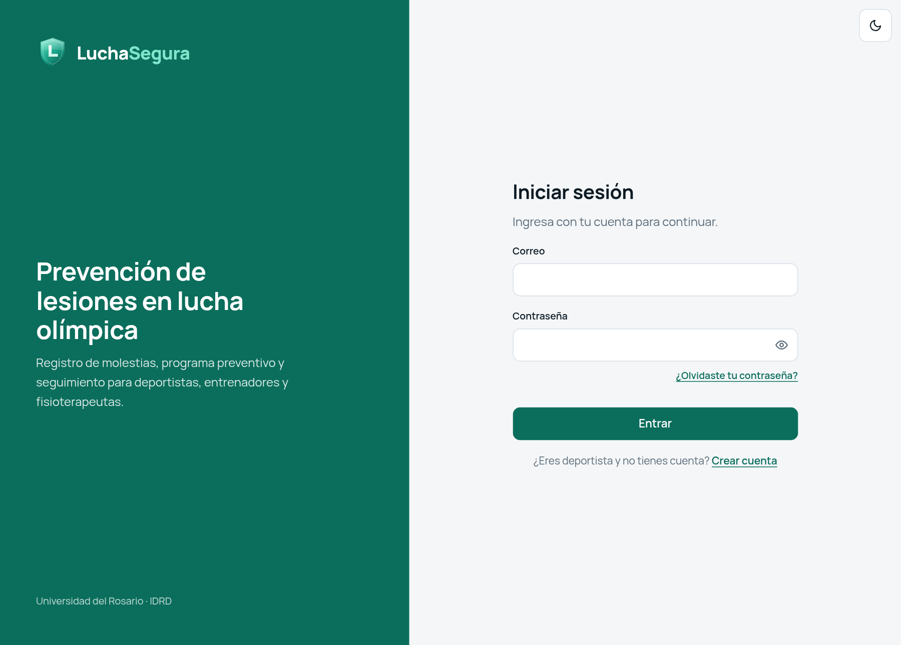
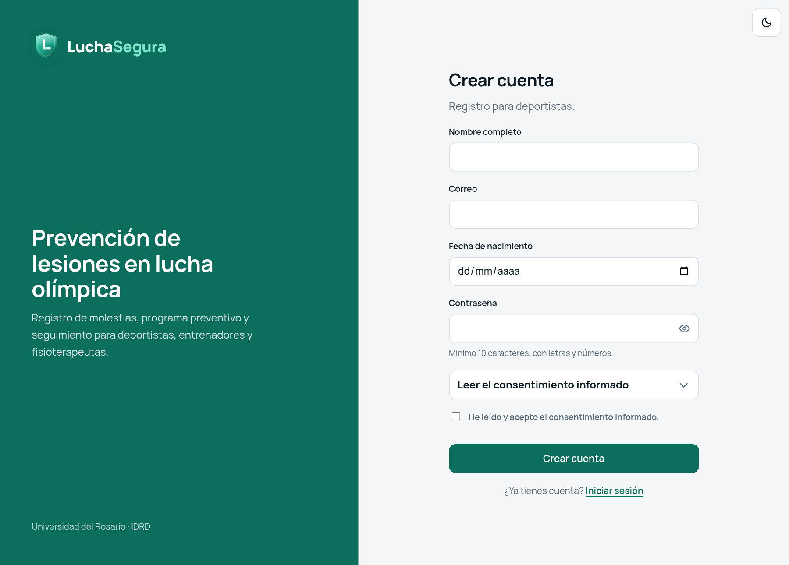
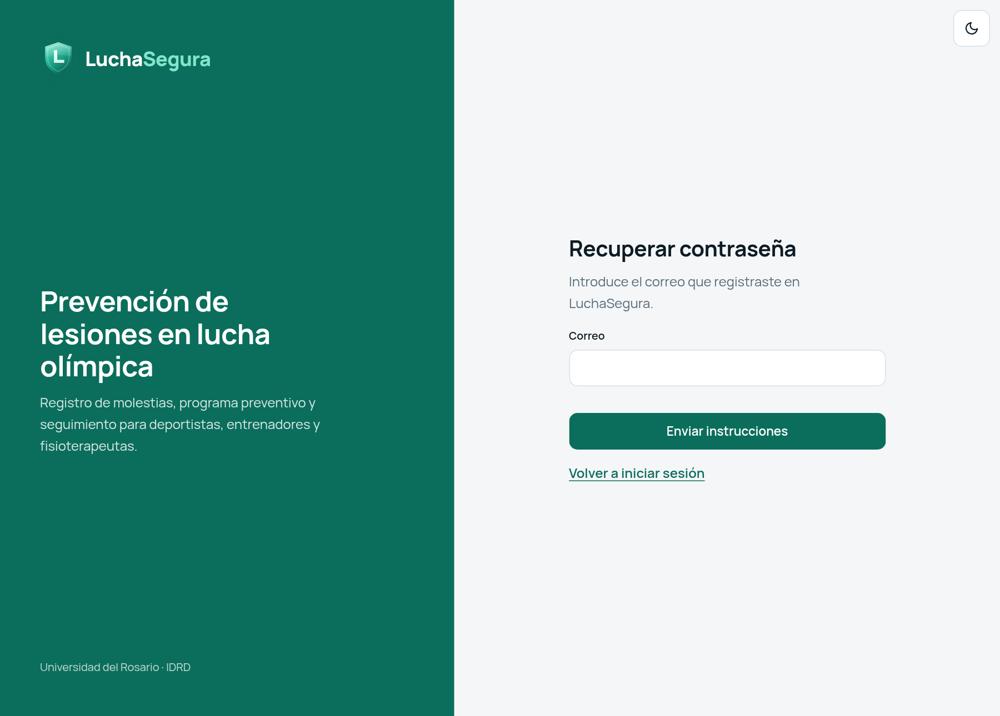
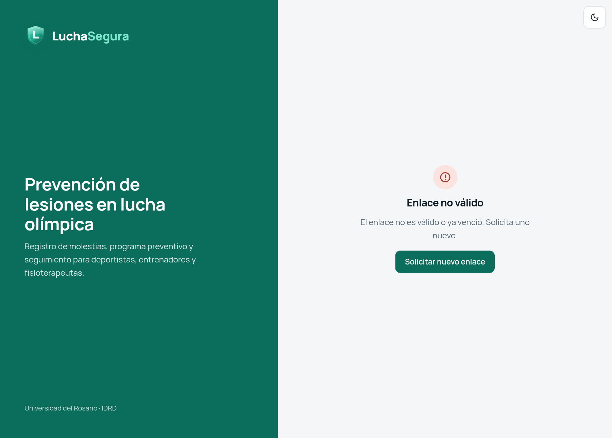
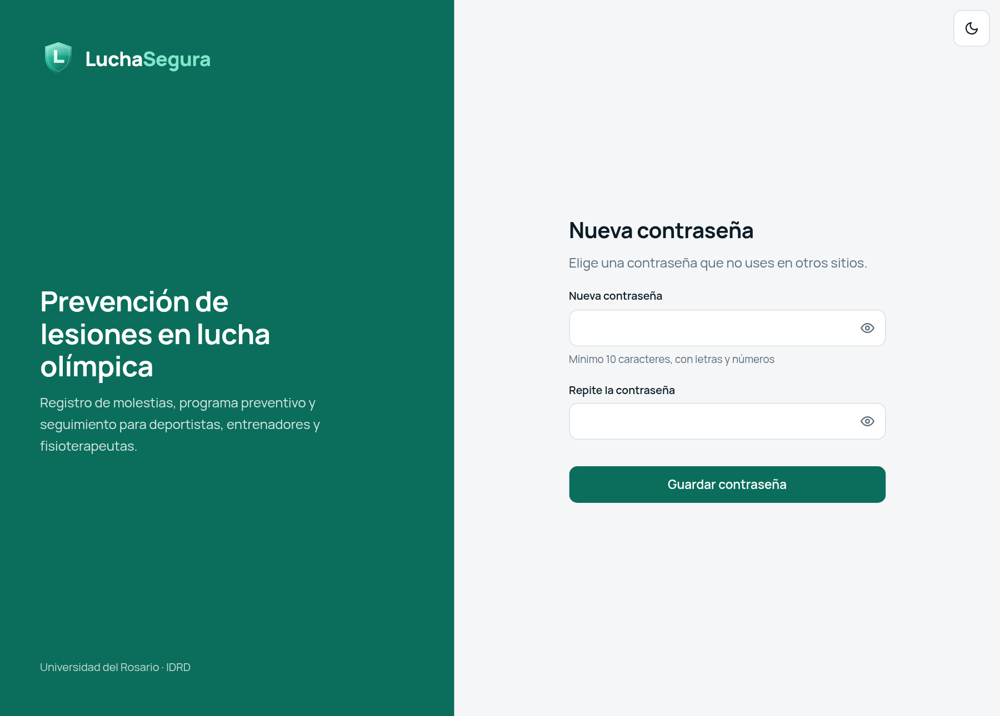
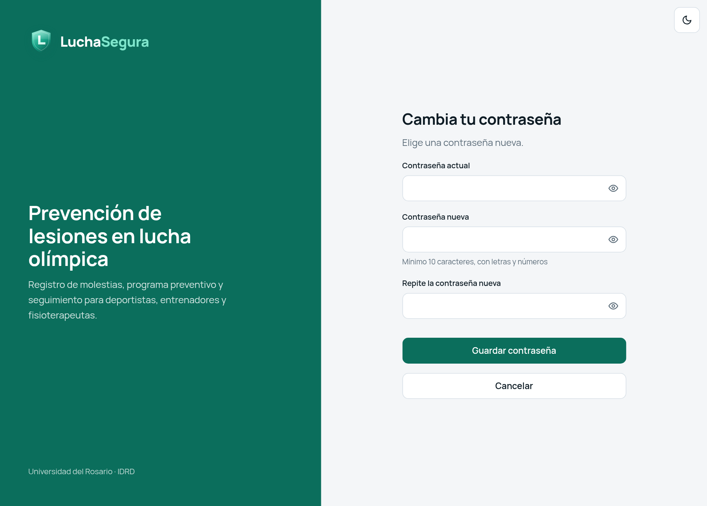

# Acceso, interfaz y navegación

## Acceso común

| Pantalla | Campos y acciones | Resultado esperado |
| --- | --- | --- |
| **Iniciar sesión** | Correo válido y contraseña. **Entrar** envía el formulario. **Crear cuenta** abre el registro y **¿Olvidaste tu contraseña?** abre recuperación. El control del campo de contraseña permite mostrarla u ocultarla. | Administrador llega a Usuarios, deportista a Inicio, y el equipo a Resumen. Si se supera el límite de intentos, espera el tiempo indicado. |
| **Crear cuenta** | Nombre completo, correo, fecha de nacimiento, contraseña y aceptación del tratamiento. Si la persona es menor, aparece el nombre del acudiente y cambia el texto de aceptación. | Se crea una cuenta de deportista. Revisa errores junto a los campos. La fecha futura y el correo ya registrado se rechazan. |
| **Recuperar contraseña** | Escribe el correo registrado y pulsa **Enviar instrucciones**. Vuelve a Inicio de sesión desde el enlace inferior. | La respuesta pública es uniforme cuando el servicio puede aceptar solicitudes. Consulta la bandeja y correo no deseado. |
| **Nueva contraseña** | Abre el enlace del correo, escribe y repite la contraseña. Guarda el cambio. | Si el enlace ya se usó, caducó o falta, solicita otro. Tras el cambio, accede con la nueva contraseña. |
| **Cambia tu contraseña** | Introduce contraseña actual, nueva y confirmación. Pulsa **Guardar contraseña**. | Si la cuenta fue creada con contraseña temporal, completa el cambio antes del primer acceso al panel. |

Usa al menos diez caracteres, con letras y números para una contraseña nueva. El servidor limita la contraseña a 72 bytes UTF-8. La confirmación debe coincidir. El cambio revoca credenciales de sesión previas. Consulta el [capítulo de recuperación](16_REPORTES_Y_RECUPERACION.md).

## Navegación y estados comunes

El menú muestra el espacio del perfil. El tema puede alternarse desde el control de apariencia. En pantallas estrechas, el espacio del deportista y el del equipo adaptan la navegación al ancho disponible. Las fichas usan pestañas y las secciones desplegables conservan el contexto de la página. Cierra sesión desde el menú de equipo o administración, o desde **Perfil** en deportista. La aplicación cierra la sesión tras 30 minutos de inactividad.

Cuando una lista está vacía, revisa los filtros y el alcance de tu perfil. Un error transitorio permite reintentar en las vistas que muestran esa acción. Antes de enviar de nuevo una escritura interrumpida, verifica si el resultado ya está en pantalla. Una sección en carga puede mostrar un esqueleto visual mientras se recuperan los datos.

- [Administrador](12_ADMINISTRADOR.md)
- [Fisioterapeuta](13_FISIOTERAPEUTA.md)
- [Deportista](14_DEPORTISTA.md)
- [Entrenador](15_ENTRENADOR.md)

## Pantallas de acceso y contraseña

