# Diagramas de flujo

Los rectángulos distinguen acciones de usuario y de sistema mediante su etiqueta. Los rombos indican decisiones.

## 1. Flujo general

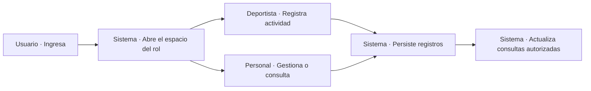

Los espacios comparten una base y cada consulta aplica los permisos correspondientes.

## 2. Autenticación y navegación

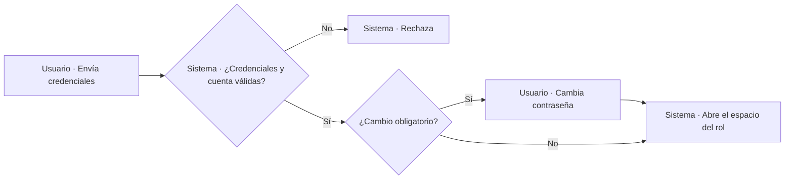

Administrador va a Usuarios, deportista a Inicio y fisioterapeuta o entrenador a Resumen.

## 3. Administración de usuarios

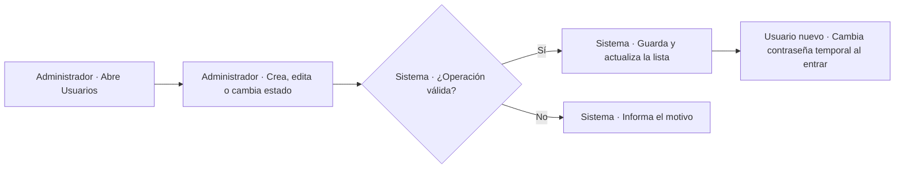

La última acción corresponde al alta. Los cambios de rol respetan los vínculos existentes.

## 4. Alta de deportista y asignación

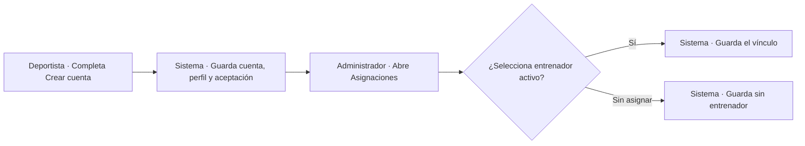

El entrenador obtiene acceso a la ficha deportiva al existir la asignación.

## 5. Antecedentes

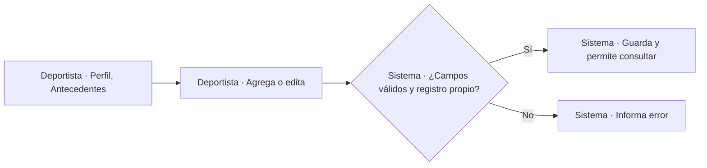

La edición aplica a antecedentes propios editables. El alta de antecedentes carece de generación de alertas.

## 6. Registro de molestias

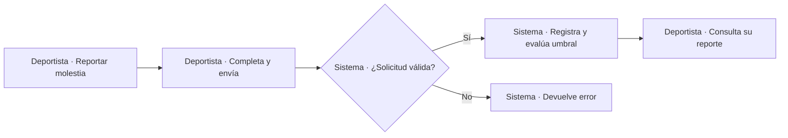

El servidor conserva el identificador de envío para resolver reintentos equivalentes.

## 7. Generación de alertas

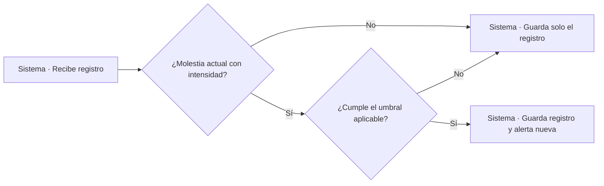

Se usa la regla específica de zona si existe, o la general. Dentro de cada alcance prevalece la más reciente.

## 8. Revisión por fisioterapia

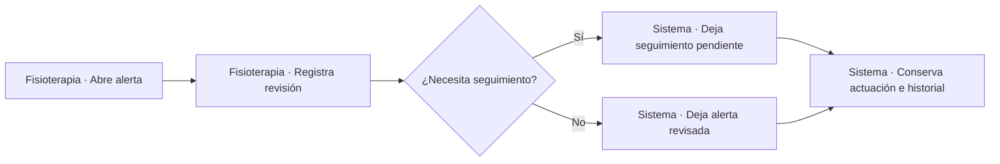

Se registran observaciones y actuación. Iniciar revisión registra una transición intermedia.

## 9. Seguimiento y finalización

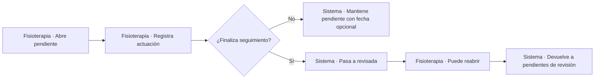

Cada revisión y reapertura agrega una actuación. El historial conserva el contexto anterior.

## 10. Programa preventivo de ocho semanas

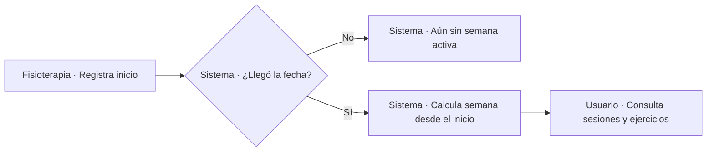

La propuesta considera tres sesiones semanales durante ocho semanas. La aplicación usa las semanas del plan vigente y el calendario de Bogotá.

## 11. Sesiones completadas

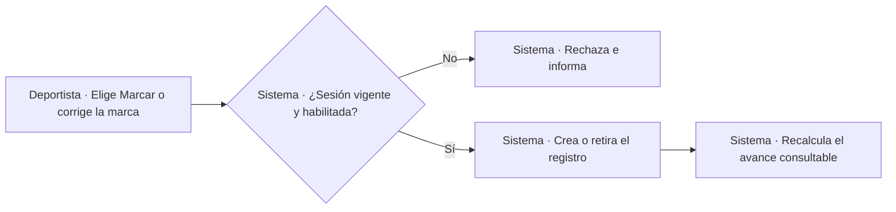

La marca expresa una declaración del deportista y se conserva al recargar.

## 12. Ejercicio individual

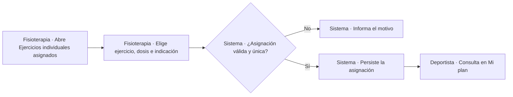

La dosificación individual tiene prioridad sobre la general. El ejercicio se consulta separado de las sesiones.

## 13. Exportación Excel

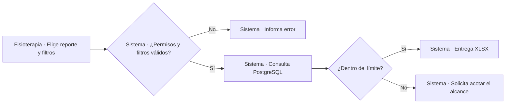

El libro usa identificación directa o seudonimizada según la opción seleccionada.

## 14. Permisos

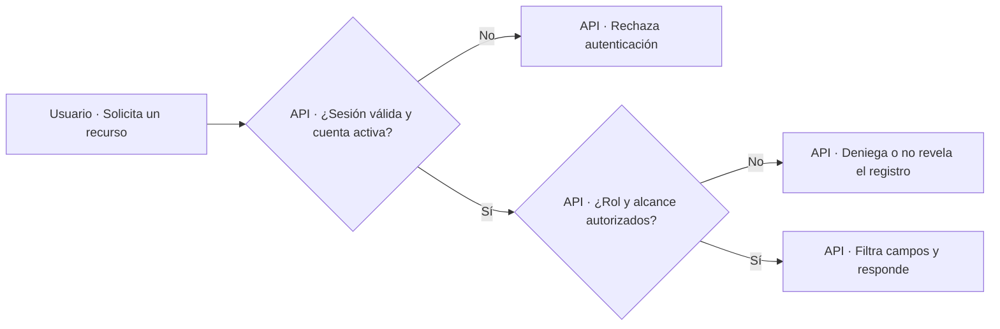

Angular orienta la navegación. La autorización de los datos se aplica en cada ruta de la API.
