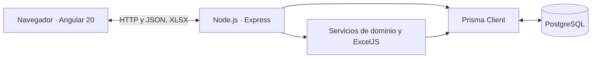
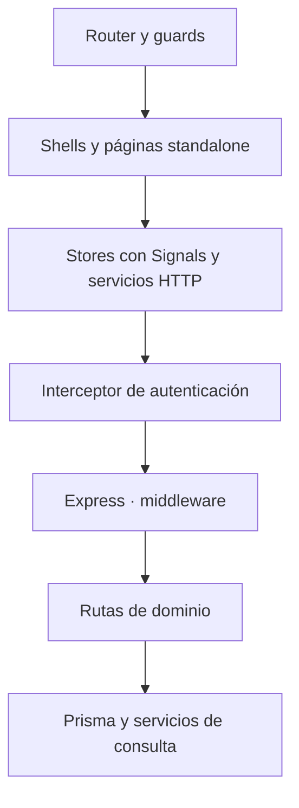
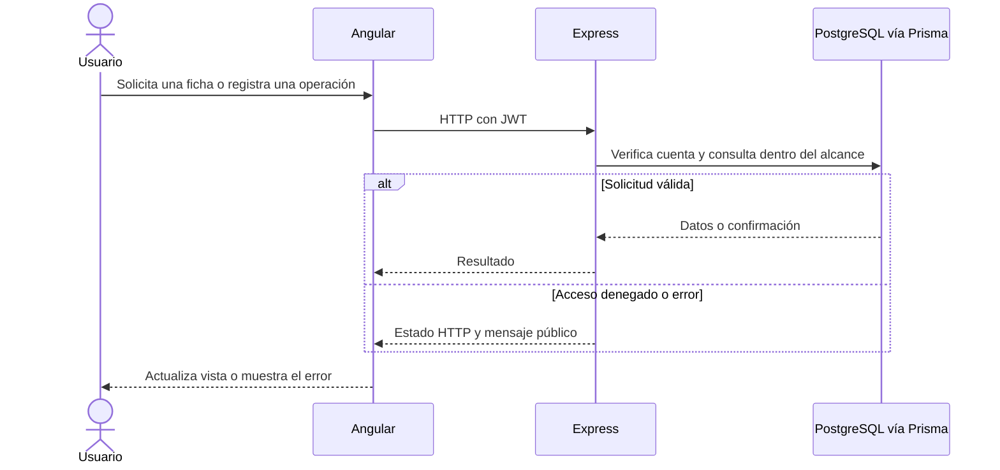

# Arquitectura técnica

## Aplicación y persistencia

## Componentes y capas

Angular usa TypeScript, formularios reactivos, Angular Router y SCSS. Las vistas se cargan bajo demanda por rol. `AthleteStore` y `TeamStore` coordinan consultas y actualizaciones. La vista de equipo se comparte entre entrenador y fisioterapeuta, con diferencias de navegación y datos. La API recibe solicitudes relativas a `/api`. El proxy de desarrollo apunta a Express en el puerto 3000.

| Carpeta | Contenido |
| --- | --- |
| `frontend/src/app/core` | Sesión, guards, interceptores, tema y componentes reutilizables. |
| `frontend/src/app/admin`, `athlete`, `team`, `pages` | Espacios de rol y acceso común. |
| `backend/src/routes` | API REST y validación de operaciones. |
| `backend/src/middleware`, `services` | Autenticación, límites, errores y lógica compartida de programa, alertas y reportes. |
| `backend/prisma`, `backend/tests` | Esquema, migraciones, inicialización y pruebas. |

## Solicitud HTTP

## Rutas y decisiones técnicas

| Prefijo o ruta | Función |
| --- | --- |
| `/api/health`, `/api/auth` | Conexión y gestión de sesión. |
| `/api/admin`, `/api/athletes` | Cuentas, asignaciones y perfil. |
| `/api/injuries`, `/api/team`, `/api/team/alerts` | Registro, fichas e historial profesional. |
| `/api/program`, `/api/exercises`, `/api/rules` | Sesiones, biblioteca, asignaciones y umbrales. |
| `GET /api/team/export` | Archivo Excel para fisioterapia. |

La sesión se guarda por pestaña en `sessionStorage`. Angular aplica caducidad por 30 minutos de inactividad y el servidor verifica expiración del JWT, rol efectivo, estado activo y versión de contraseña. Las contraseñas se almacenan con bcrypt. Express utiliza Helmet, CORS, límites de solicitudes y respuestas sin caché para API. Zod valida entradas. Los errores públicos usan mensajes controlados y los fallos de datos disponen de respuesta 503.

El servidor reutiliza el cálculo de avance del programa. Las actuaciones usan versión y solicitud idempotente, y los cambios concurrentes que afectan sesiones usan transacciones. ExcelJS genera el libro con datos de PostgreSQL y texto literal para entradas de usuario. El alcance de fisioterapia comprende las fichas del equipo en la instalación actual. El entrenador se filtra por `coachId`. [Permisos y pruebas](07_PRUEBAS_Y_RESULTADOS.md)

## Configuración

| Variable de backend | Uso |
| --- | --- |
| `DATABASE_URL` | Conexión requerida por Prisma. |
| `JWT_SECRET` | Secreto requerido, aleatorio y de al menos 32 caracteres. |
| `JWT_EXPIRES_IN` | Duración con unidad, por defecto `2h`. |
| `PORT` | Puerto HTTP, por defecto `3000`. |
| `CORS_ORIGIN` | Origen permitido, por defecto `http://localhost:4200`. |
| `TRUST_PROXY_HOPS` | Saltos de proxies confiables, por defecto cero. |
| `NODE_ENV` | Activa reglas de producción al configurarse como `production`. |

[Montaje local](08_INSTALACION_Y_EJECUCION.md) · [Registro de rutas](../../backend/src/app.ts) · [Esquema Prisma](../../backend/prisma/schema.prisma)
