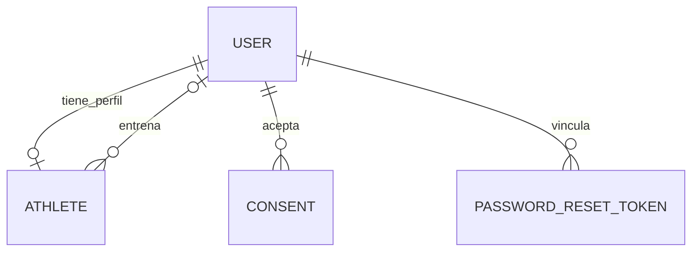
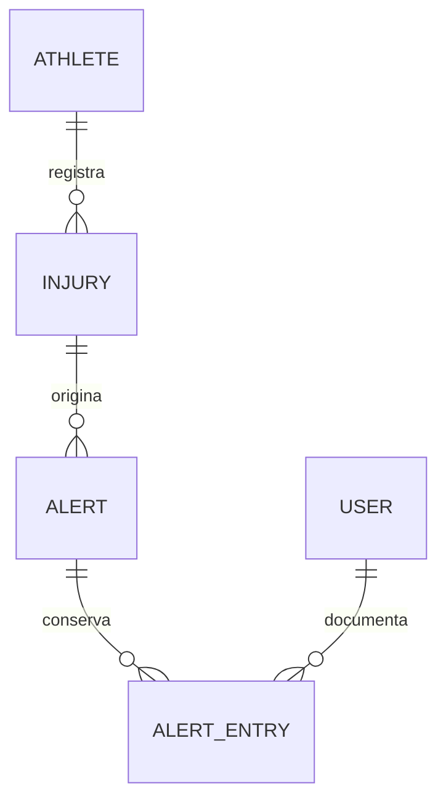
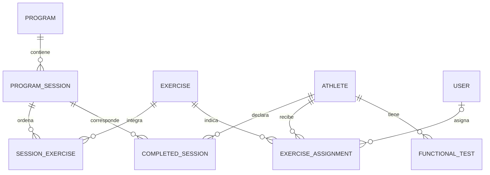

# Modelo de datos

PostgreSQL conserva el modelo definido en Prisma. Las cardinalidades describen registros y claves del esquema. Las reglas de rol se aplican en la API. [Esquema fuente](../../backend/prisma/schema.prisma)

## Identidad, perfiles y acceso

`User.role` admite `ADMIN`, `PHYSIO`, `COACH` y `ATHLETE`. El entrenador es un `User` referenciado opcionalmente por `Athlete.coachId`. La API valida que el entrenador esté activo al asignarlo. El modelo carece de una relación individual de asignación fisioterapeuta–deportista.

## Molestias y actuaciones

`Injury.isHistory` distingue antecedentes y molestias. `AlertRule` contiene zona opcional e intensidad mínima. `createdById` es un campo escalar, sin FK declarada. `AlertEntry` representa revisiones y seguimientos, incluidos inicio y reapertura. No existe una tabla separada de seguimiento. Las relaciones de alerta y autor en `AlertEntry` usan `NoAction` para proteger el historial.

## Programa, ejercicios y mediciones

El inicio de intervención es una fecha civil en `Athlete.programStartedAt`. La aplicación selecciona el primer programa con sesiones según el orden de ID. El esquema carece de asignación individual de programa. `FunctionalTest` almacena fase `INITIAL` o `FINAL`, tipo, fecha y un resultado JSON. El software ofrece consulta profesional de registros existentes.

## Claves y restricciones

| Entidad | Claves y restricciones relevantes |
| --- | --- |
| `User` | PK `id`, correo único, rol enumerado y estado activo. |
| `Athlete` | PK `id`, FK única `userId`, FK opcional `coachId` con `SetNull`. |
| `Consent` | PK `id`, FK `userId`, versión del texto y fecha, acudiente opcional. |
| `PasswordResetToken` | PK `id`, FK `userId`, hash único, vencimiento y uso. |
| `Injury` | PK `id`, FK `athleteId`, índice por deportista y ocurrencia. |
| `AlertRule` | PK `id`, zona opcional y mínimo de intensidad. |
| `Alert` | PK `id`, FK `injuryId`, estado enumerado y versión. |
| `AlertEntry` | PK `id`, FK `alertId` y `authorId`. Unicidad de alerta y versión, y de alerta y solicitud. |
| `Program` | PK `id`, semanas y frecuencia configurables. |
| `ProgramSession` | PK `id`, FK `programId`, único por programa, semana y número. |
| `Exercise` | PK `id`, componente indexado y marca de archivo. |
| `SessionExercise` | PK compuesta por las FK `sessionId` y `exerciseId`, con posición. |
| `CompletedSession` | PK `id`, FK `athleteId` y `sessionId`, combinación única. |
| `ExerciseAssignment` | PK `id`, FK `athleteId` y `exerciseId`, combinación única. FK opcional `assignedById` con `SetNull`. |
| `FunctionalTest` | PK `id`, FK `athleteId` e índice por deportista y fase. |

Las migraciones incluyen el esquema inicial, recuperación, seguridad e índices, asignaciones de ejercicios, historial de alertas e inicio de intervención. [Migraciones](../../backend/prisma/migrations)
