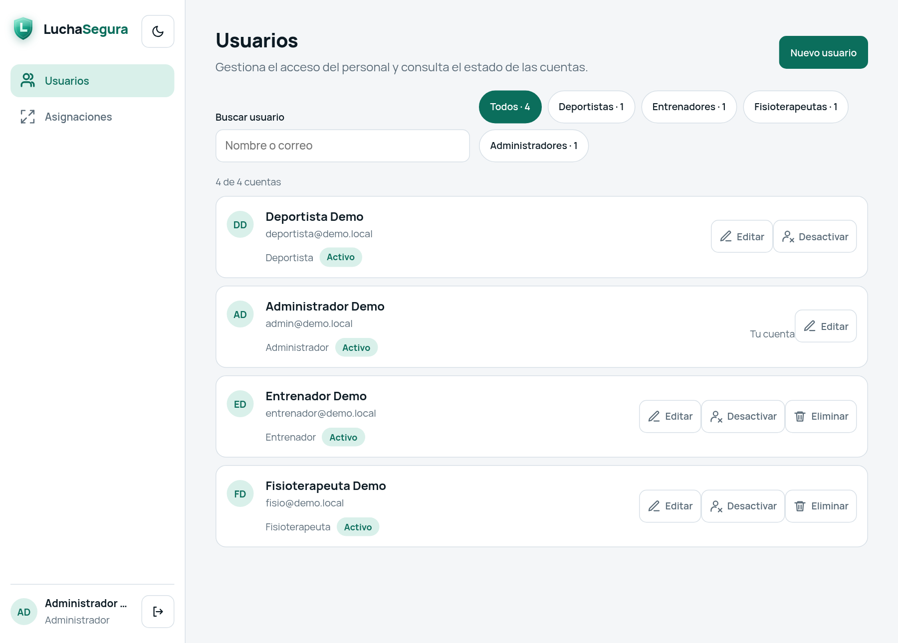
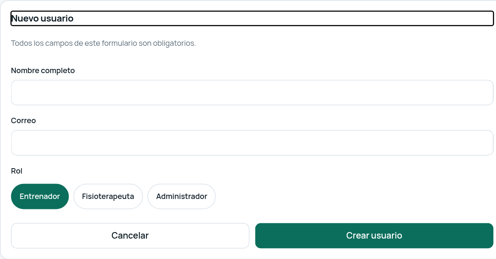
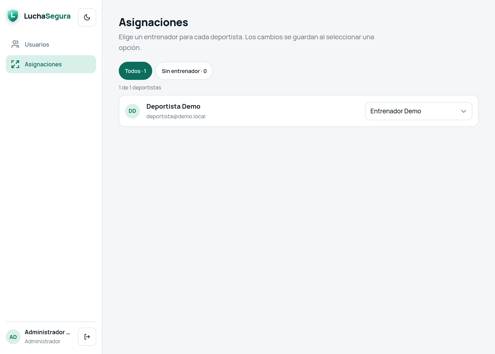

# Manual del administrador

## Usuarios

**Ruta** `/admin`. Busca por nombre o correo y filtra por rol. Los contadores indican el conjunto de cuentas cargado y la lista indica cuántas coinciden. **Limpiar filtros** restaura la búsqueda cuando falta un resultado.

1. Abre **Nuevo usuario**. Completa nombre y correo y elige Administrador, Fisioterapeuta o Entrenador. Pulsa **Crear usuario**. Para crear un perfil deportista se usa el registro público.
2. Pulsa **Copiar contraseña** y cierra la tarjeta con **Listo** tras verificar que guardaste la contraseña temporal. Compártela mediante un canal autorizado. La persona debe cambiarla al entrar por primera vez.
3. En **Editar**, actualiza nombre, correo y rol cuando esté habilitado. Usa **Guardar cambios** o **Cancelar**. Los correos duplicados y las transiciones incompatibles con vínculos se rechazan. Puedes editar los datos permitidos de tu cuenta. Su rol y activación quedan protegidos.
4. Usa **Activar** o **Desactivar** según el estado de una fila y confirma si la interfaz lo solicita. La desactivación impide autenticación y conserva los vínculos.

## Asignaciones

**Ruta** `/admin/asignaciones`. Localiza al deportista. En el selector de su fila, elige un entrenador activo o **Sin asignar**. Tras guardar, comprueba el valor mostrado. Si falta un entrenador, revisa su rol y su estado en Usuarios. Al retirar o cambiar una asignación se actualiza el alcance del entrenador en la siguiente consulta.

En cuentas de personal elegibles, **Eliminar** abre una confirmación. La API protege tu propia cuenta, las cuentas de deportistas y las cuentas con referencias protegidas. Usa la desactivación si debes conservar la identidad.

La operación de administración se limita al acceso, identidad y asignación. Para el alcance clínico, consulta [Permisos y limitaciones](10_LIMITACIONES_Y_PENDIENTES.md).
