# Manual del fisioterapeuta

## Resumen y lista de alertas

En **Resumen** (`/equipo`), revisa indicadores, próximos seguimientos, pendientes vencidos y entradas sin fecha. Accede desde sus enlaces a los registros relacionados. El formulario **Exportar reporte a Excel** se explica en [Reportes y recuperación](16_REPORTES_Y_RECUPERACION.md).

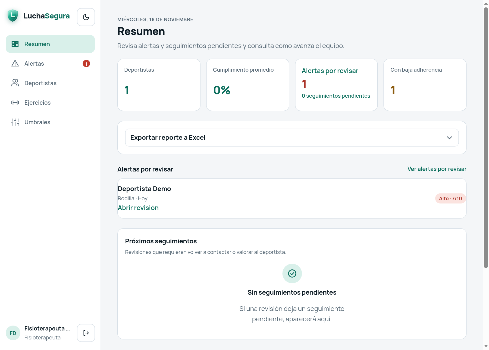

En **Alertas** (`/equipo/alertas`), busca por deportista o zona y filtra por estado. Los indicadores permiten distinguir pendientes de revisión de seguimientos y elementos resueltos. Abre la fila para consultar el detalle.

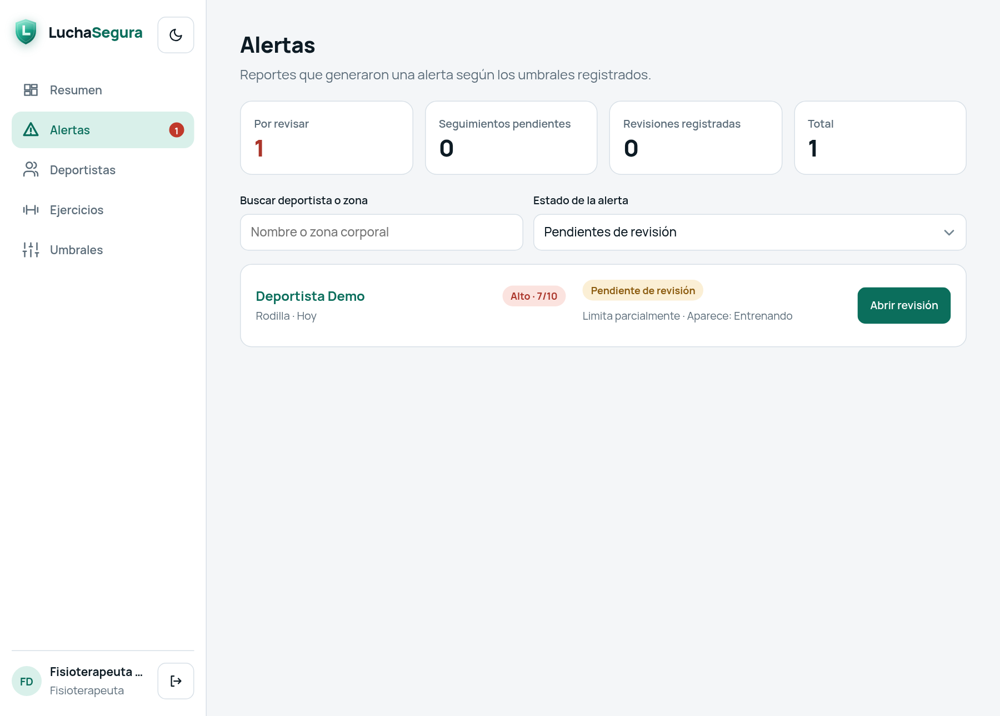

## Revisión y seguimiento

1. Abre `/equipo/alertas/:id` desde la lista. Verifica el reporte, contexto del deportista y actuaciones previas.
2. Usa **Iniciar revisión** para registrar el comienzo cuando esté disponible. Completa **Observaciones del profesional** y **Actuación realizada**. El desplegable opcional contiene hallazgos de la valoración, recomendaciones o indicaciones y remisión.
3. Marca **Necesita seguimiento** si corresponde. La fecha sugerida es opcional y se valida como fecha civil. Pulsa **Guardar revisión**. Comprueba el estado y el historial.
4. En un seguimiento pendiente, registra observaciones y actuación. En **Acción de seguimiento**, selecciona mantener pendiente o finalizar y guarda. En una alerta revisada puedes usar **Reabrir alerta** con motivo obligatorio.
5. Si se informa un conflicto, vuelve a consultar el detalle para trabajar sobre su versión actual. Los controles de guardado se deshabilitan durante el envío. El historial conserva autor, fecha, acción y orden.

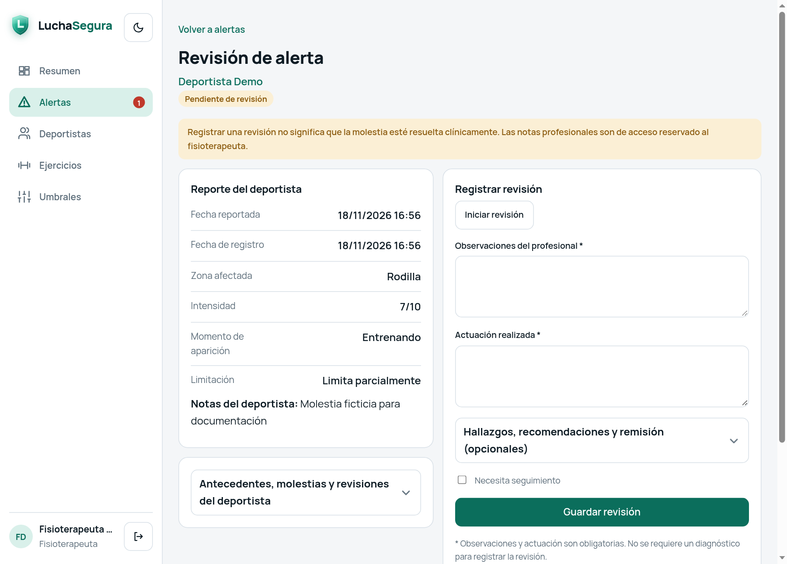

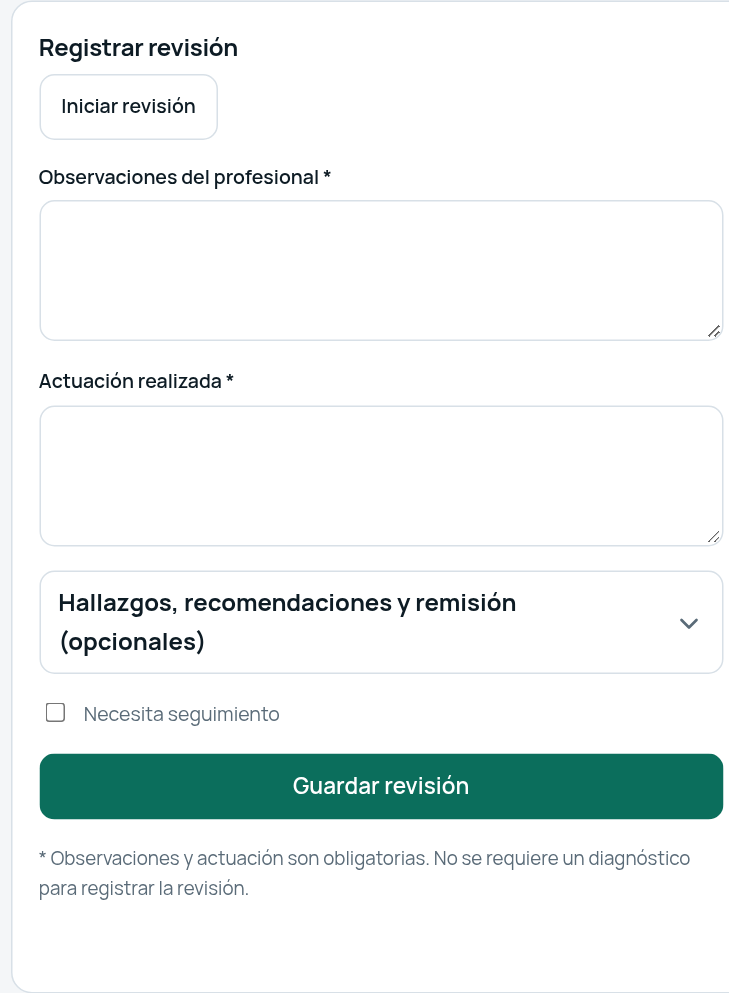

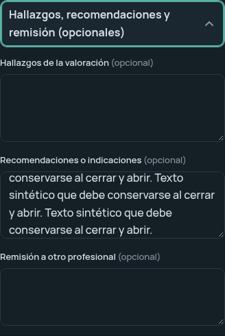

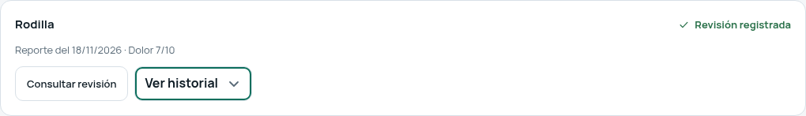

## Deportistas y ficha

En **Deportistas** (`/equipo/deportistas`), busca por el texto admitido y abre una ficha. Una ficha carga sus módulos según la pestaña y los datos existentes.

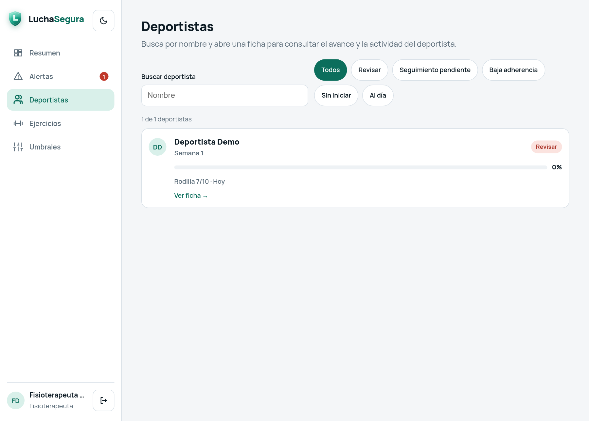

| Pestaña | Lectura y acciones |
| --- | --- |
| Resumen | Identificación, datos deportivos e indicadores. Abre accesos directos a revisiones y programa. |
| Antecedentes y molestias | Consulta antecedentes y reportes recientes, su contexto e intensidad cuando exista. |
| Revisiones y seguimientos | Consulta el historial profesional, abre la revisión asociada y localiza pendientes. |
| Programa y ejercicios | Registra la fecha real de inicio, selecciona semana y despliega sesiones. Abre cada ejercicio para consultar su indicación. Gestiona asignaciones individuales aparte del plan. |
| Evaluaciones | Consulta registros iniciales y finales, tipo, fecha y resultado disponible. El vacío de una fase señala la ausencia de registros en esa ficha. La pantalla es de consulta. |

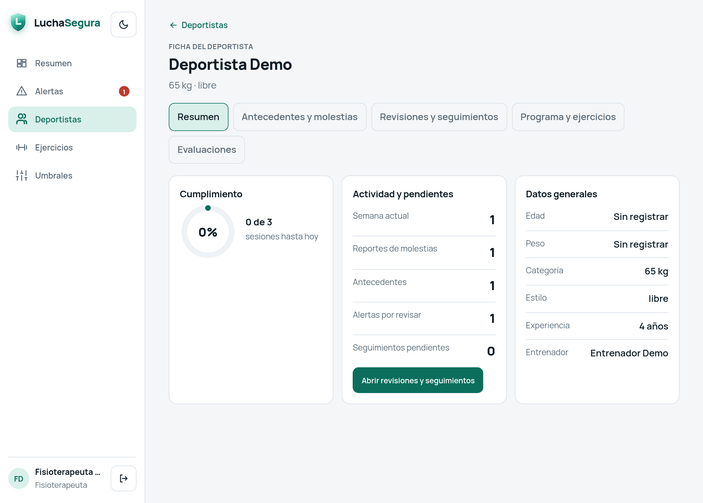

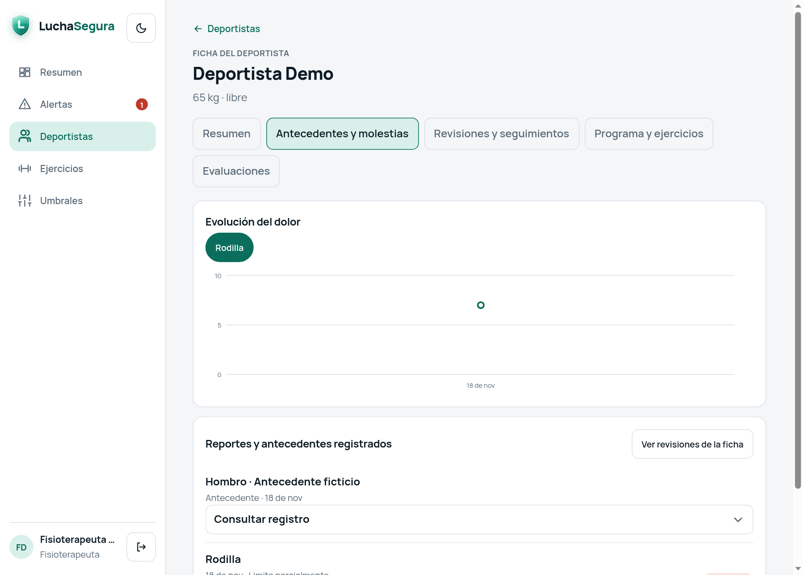

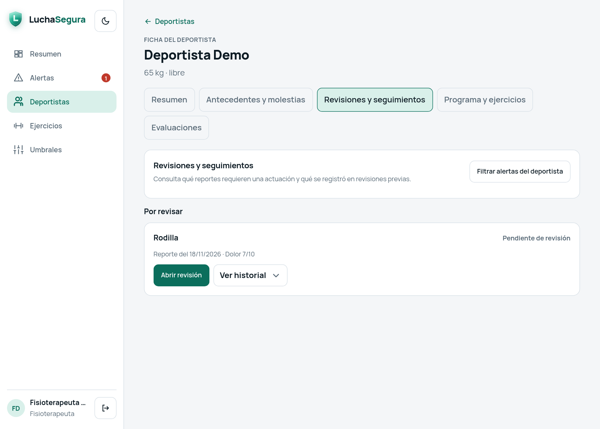

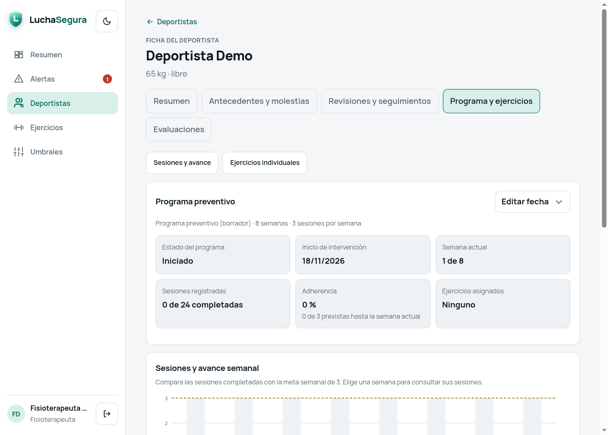

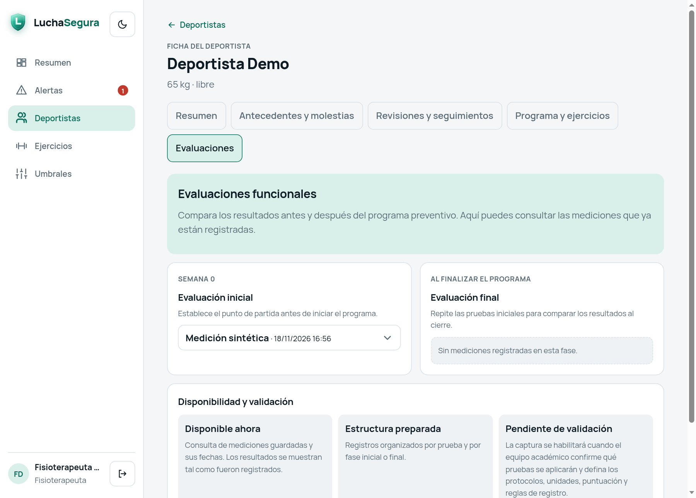

En el editor de inicio, indica la fecha civil real y pulsa **Guardar inicio**. El servidor valida la fecha y rechaza cambios incompatibles con sesiones registradas. En **Asignar ejercicio**, selecciona un elemento activo del catálogo y añade dosificación o indicaciones si corresponden. Guarda y confirma su aparición. Para retirar una asignación, usa **Quitar** y confirma. Si hay duplicidad, revisa la lista.

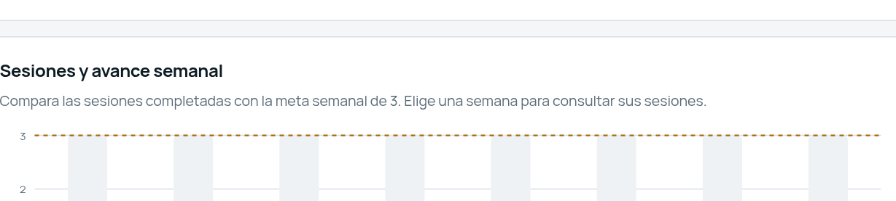

## Biblioteca y umbrales

**Ejercicios** (`/equipo/ejercicios`) permite buscar y filtrar por componente, abrir una tarjeta y consultar la descripción. Pulsa **Nuevo ejercicio** o **Editar** para elegir componente e indicar nombre, cómo se hace, dosificación, zona y enlace de video o ilustración. Nombre y componente son necesarios. Usa **Guardar** o **Cancelar**. **Eliminar** solicita confirmación. Los ejercicios vinculados pueden archivarse para conservar sus referencias.

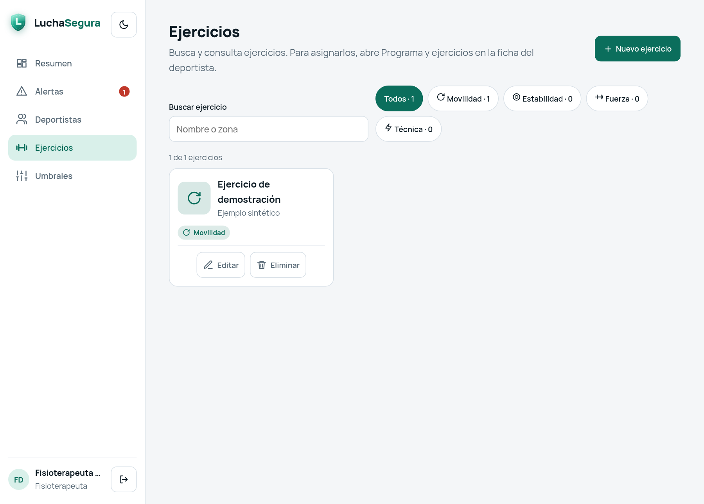

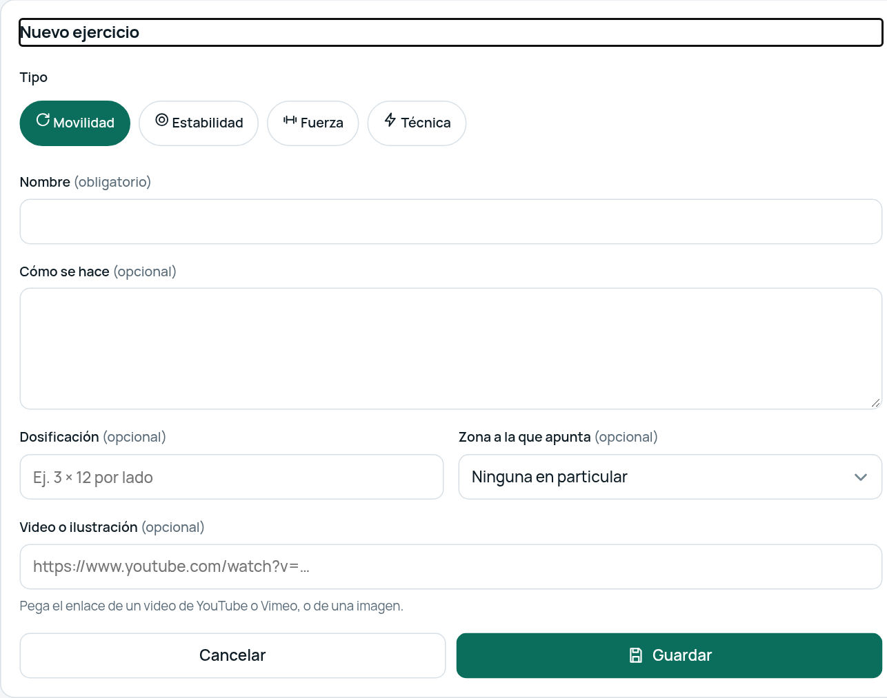

En **Umbrales** (`/equipo/umbrales`), elige **Zona** o **Todas las zonas**, selecciona **Alertar desde** entre 1 y 10 y pulsa el botón de guardado. La lista muestra las reglas actuales y permite eliminar una regla tras confirmar. Usa valores autorizados por el equipo y consulta [Diagramas de flujo](03_DIAGRAMAS_DE_FLUJO.md).

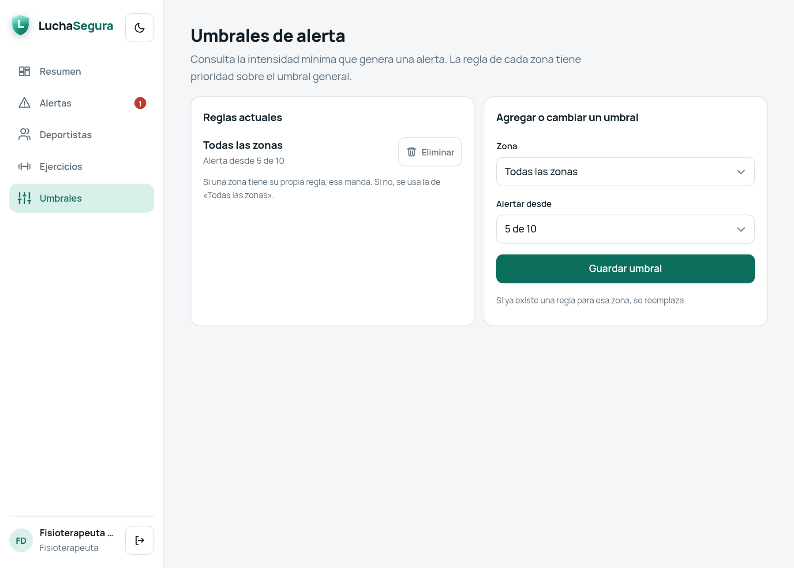
