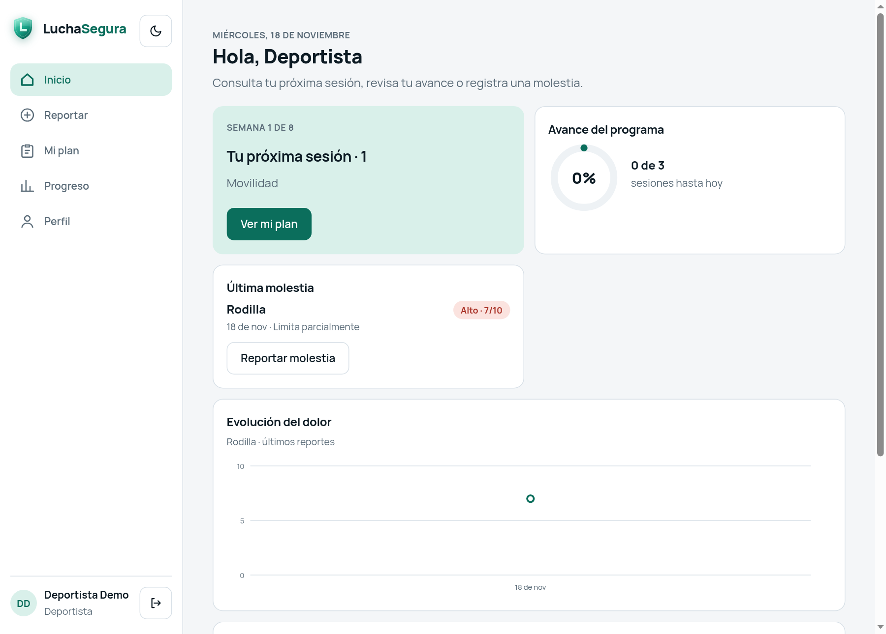
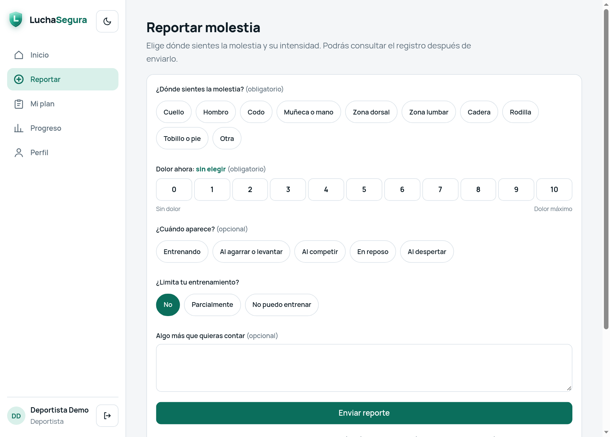
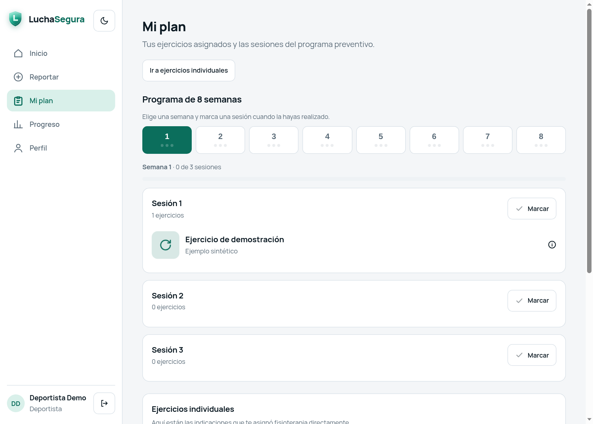
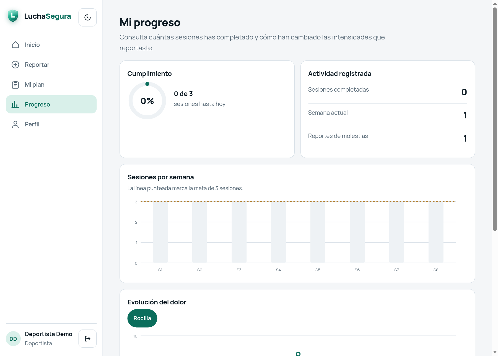
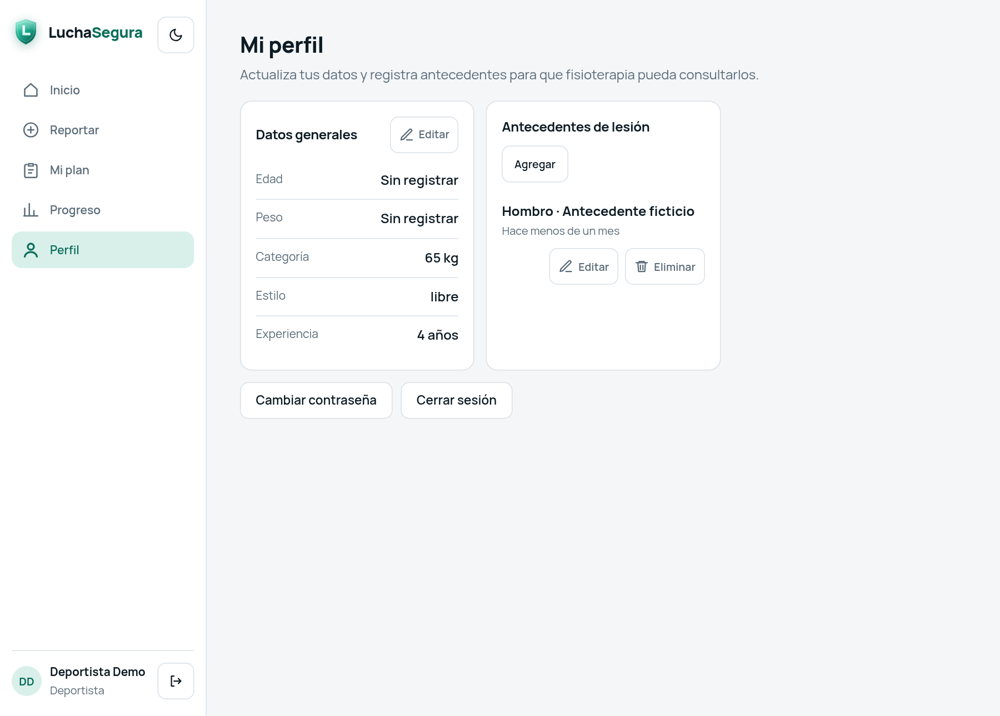
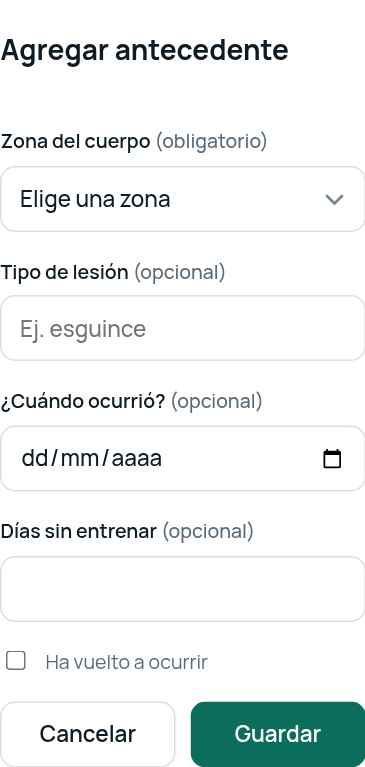

# Manual del deportista

## Inicio

En `/deportista` consulta próxima sesión, avance, última molestia, evolución del dolor y sesiones por semana. Desde los accesos principales puedes ir a **Mi plan** o **Reportar molestia**. El estado distingue un programa sin inicio registrado de una semana completada o la ausencia de programa.

## Reportar molestia

En `/deportista/reportar`, selecciona la zona corporal y una intensidad entre 0 y 10. Selecciona momento y nivel de limitación cuando corresponda. Añade información opcional en **Algo más que quieras contar**. Pulsa **Enviar reporte** y verifica **Tus últimos reportes**. El formulario pide los datos obligatorios antes de enviar. Si hay un error de conexión, revisa el resultado antes de repetir el envío.

Las filas muestran los estados que puede consultar el deportista. Cuando aparece **Eliminar**, confirma la acción después de verificar el registro. Una actuación profesional existente protege el historial y bloquea el borrado.

## Mi plan

En `/deportista/plan`, selecciona una semana, abre una sesión y consulta sus ejercicios. El botón **Marcar** declara su realización y se actualiza a **Completada**. Puedes revertir la marca en una sesión habilitada. Las semanas futuras y los planes sin inicio limitan la escritura. Usa **Ir a ejercicios individuales** para consultar cada ficha, su dosificación e indicaciones. El registro de cumplimiento corresponde a las sesiones del programa. **Recuperación y cuidado** reúne orientaciones de lectura.

## Mi progreso

En `/deportista/progreso`, consulta cumplimiento, actividad registrada, sesiones por semana, evolución del dolor y disponibilidad de pruebas funcionales. Filtra la evolución del dolor por zona cuando haya registros. Interpreta los valores como datos autodeclarados de actividad y molestias.

## Mi perfil

En `/deportista/perfil`, pulsa **Editar** para actualizar fecha de nacimiento, peso, categoría, estilo, años de experiencia y observaciones. Guarda los cambios o cancela. La fecha de nacimiento debe ser válida y no futura. El peso admite 25 a 200 kg, la experiencia entera de 0 a 50 años y las observaciones hasta 1.000 caracteres.

En **Antecedentes de lesión**, pulsa **Agregar** o **Agregar antecedente**, elige la zona obligatoria e indica tipo, fecha y días sin entrenar si los conoces. Marca **Ha vuelto a ocurrir** si corresponde. Guarda el antecedente. Los controles **Editar** y **Eliminar** actúan sobre registros propios y la eliminación pide confirmación. El tipo admite hasta 80 caracteres, la fecha no puede ser futura y los días sin entrenar admiten enteros de 0 a 3.650. Un antecedente se registra aparte de una molestia actual.

Usa **Cerrar sesión** al terminar, especialmente si el dispositivo es compartido.

