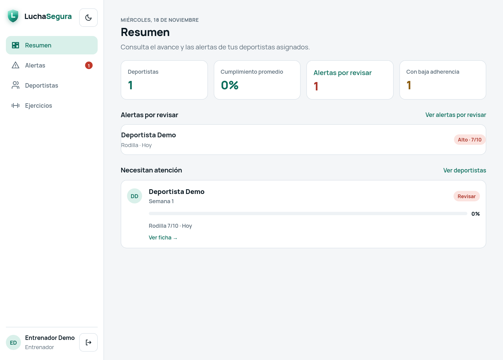
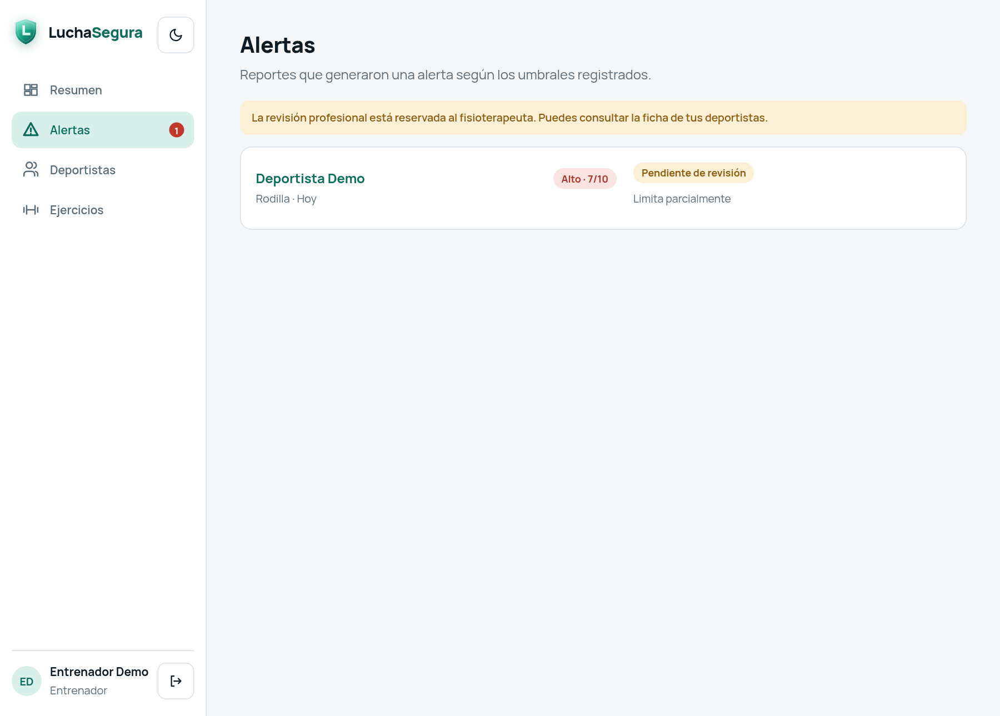
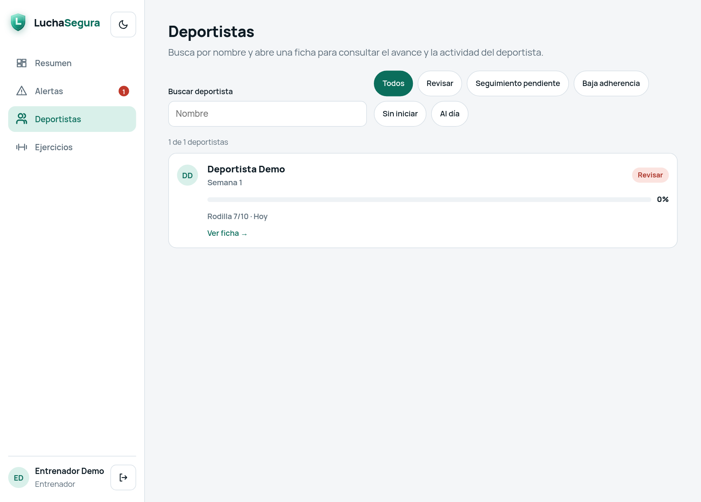
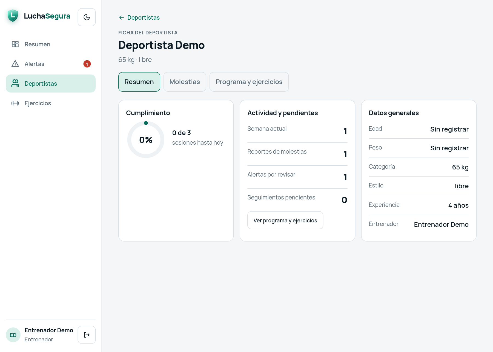
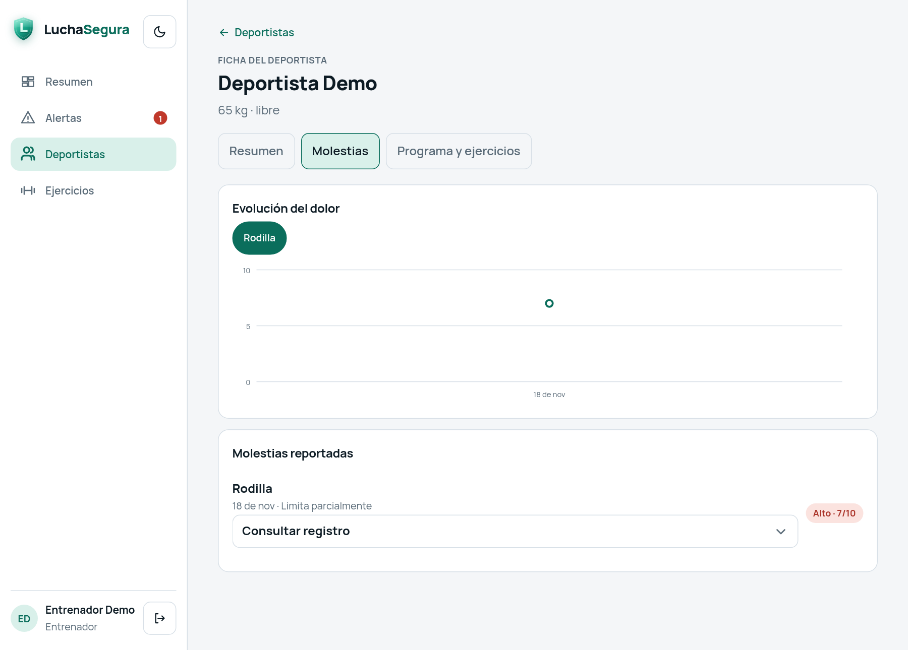
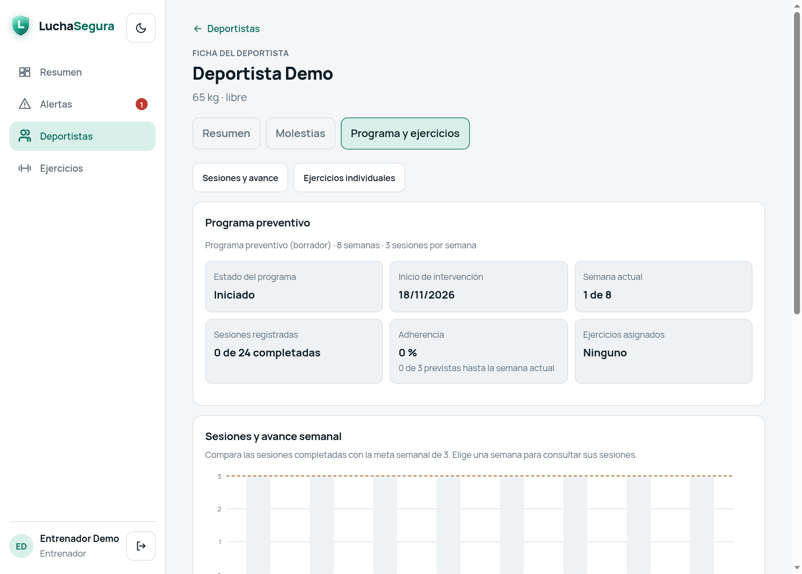
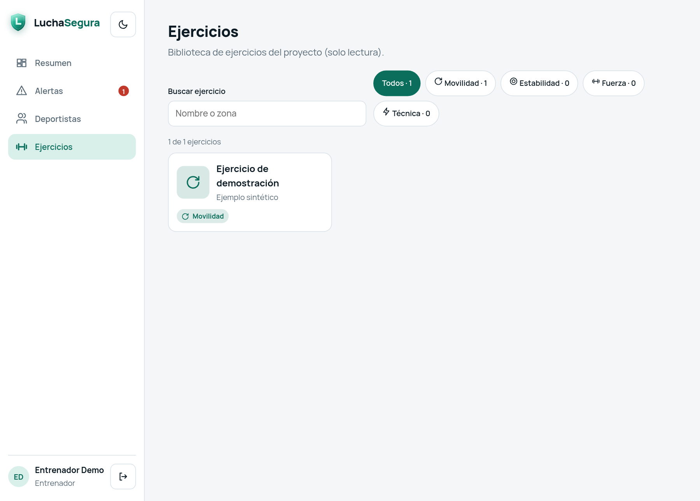
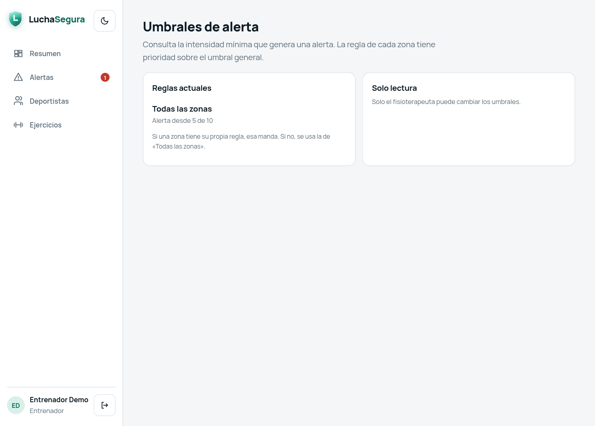

# Manual del entrenador

El espacio de equipo se filtra por la asignación vigente. Si falta una persona en el listado, comprueba con administración que el vínculo esté activo.

## Resumen, alertas y deportistas

- **Resumen** (`/equipo`). Consulta tamaño del grupo, avance e indicadores deportivos de tus asignaciones.
- **Alertas** (`/equipo/alertas`). Consulta las alertas pendientes de revisión de tus asignaciones y abre la ficha desde el nombre del deportista. El detalle de revisión profesional está reservado a fisioterapia.
- **Deportistas** (`/equipo/deportistas`). Localiza una persona y abre su ficha. Si los filtros dejan la lista vacía, ajusta el texto y comprueba la asignación.

## Ficha y ejercicios

En la ficha, usa **Resumen**, **Molestias** y **Programa y ejercicios** cuando estén disponibles. Selecciona la semana y abre una sesión para consultar en modo lectura la actividad declarada. Las observaciones profesionales, evaluaciones y exportaciones clínicas se mantienen en el espacio de fisioterapia.

En **Ejercicios** (`/equipo/ejercicios`), busca por texto y selecciona un componente. Abre la tarjeta para consultar el detalle. La creación, edición, eliminación y asignación corresponden a fisioterapia.

**Umbrales** queda fuera del menú del entrenador. La ruta directa `/equipo/umbrales` abre una vista de solo lectura con las reglas actuales.

