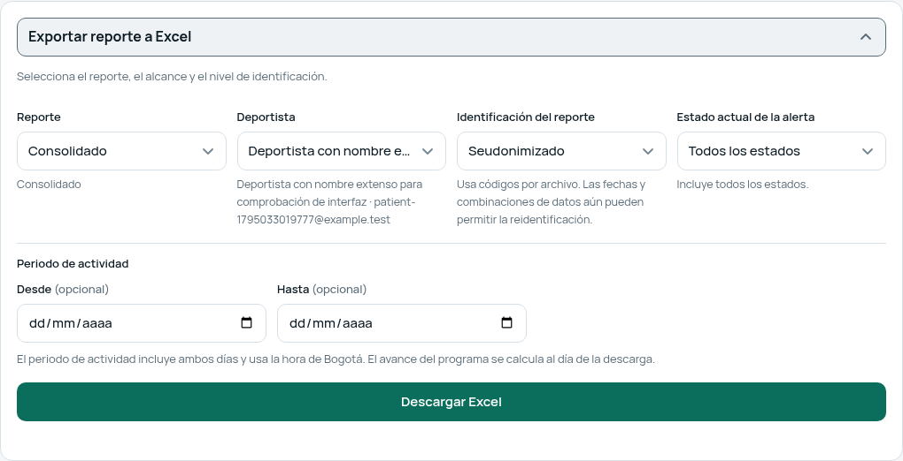
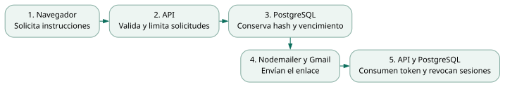

# Procesos operativos, Excel y recuperación

## Del reporte a la actuación profesional

El deportista puede guardar un antecedente histórico o reportar una molestia actual. Los antecedentes se consultan por separado. La fecha es opcional y puede quedar sin registrar al crear o editar el antecedente. Para una molestia actual con intensidad, el servidor busca la regla de la zona y, en su ausencia, la regla general más reciente. Si la intensidad alcanza el mínimo aplicable, el reporte y la alerta se guardan en la misma transacción. Un reintento con la misma solicitud y el mismo contenido recupera el resultado anterior.

| Estado | Acción profesional y efecto |
| --- | --- |
| Pendiente de revisión | Se crea al alcanzar el umbral o al reabrir. Puede iniciarse o registrarse una revisión. |
| En revisión | Registra el inicio de la actuación. Conserva condición de pendiente de revisión. |
| Seguimiento pendiente | La revisión necesita continuidad. La agenda distingue vencidos, próximos y sin fecha. Un seguimiento puede mantener el estado pendiente. |
| Revisión registrada | Se obtiene al registrar la revisión sin seguimiento o al finalizarlo. La reapertura exige un motivo y se conserva la secuencia previa. |

El texto profesional pertenece al historial de fisioterapia. Los estados visibles para el deportista y el entrenador resumen la actuación. Cuando una escritura se cruza con otra, la versión previene que se sobrescriba el registro; debe consultarse el estado actualizado antes de continuar. Véase [manual del fisioterapeuta](13_FISIOTERAPEUTA.md).

## Del inicio al seguimiento del programa

Fisioterapia registra el inicio real como fecha civil. El servidor calcula la semana en el calendario de Bogotá. La aplicación usa el primer programa con sesiones disponibles según orden de ID. La adherencia usa la relación entre sesiones declaradas y sesiones previstas hasta la semana activa. El progreso se actualiza al registrar o revertir una sesión disponible. Los ejercicios individuales muestran la dosificación indicada cuando existe. Las dosis del catálogo se señalan como orientativas.

## Exportar un libro Excel

1. Abre **Resumen → Exportar reporte a Excel** como fisioterapeuta.
2. Selecciona el tipo de reporte y, si corresponde, un deportista. El periodo tiene inicio y fin inclusivos según el tipo de registro. **Deportistas** carece de filtro temporal. **Estado actual de la alerta** aplica al consolidado y al reporte de alertas.
3. Selecciona identificación directa o seudonimizada. Pulsa **Descargar Excel**. El nombre identifica el reporte, modo y fecha. Abre el libro y comprueba las hojas, el alcance y el periodo.
4. Ante un límite, reduce el periodo o el conjunto de deportistas y repite. Ante una descarga fallida, verifica la conexión y si se generó un archivo local antes de reintentar.

| Tipo | Contenido principal |
| --- | --- |
| Consolidado | Resumen, Deportistas, Molestias y antecedentes, Alertas y seguimientos, Historial profesional, Programa preventivo, Sesiones completadas y Ejercicios asignados. |
| Deportistas | Datos de perfil autorizados según el modo. |
| Molestias y antecedentes | Registros de ocurrencia y atributos permitidos. |
| Alertas y seguimientos | Estado actual e historial de actuaciones autorizado según el modo. |
| Programa preventivo | Inicio, avance y sesiones registradas. |
| Ejercicios asignados | Asignaciones individuales del catálogo. |

El libro seudonimizado usa códigos generados para la descarga y reduce los campos identificadores y textos libres. El modo predeterminado de la interfaz y la API es seudonimizado. El contexto puede permitir reidentificación y requiere acceso restringido. Los antecedentes sin fecha tienen la celda vacía y quedan fuera de un filtro por periodo. El servidor rechaza combinaciones inválidas con 400. Devuelve 422 al superar el límite correspondiente de 5.000 registros y 429 cuando hay dos reportes en generación. El código escribe texto literal y responde con el tipo de contenido XLSX.

## Recuperar una cuenta

1. En **¿Olvidaste tu contraseña?**, escribe el correo de la cuenta. Pulsa **Enviar instrucciones**.
2. Abre **LuchaSegura | Recuperación de contraseña** en la cuenta registrada. Usa **Restablecer contraseña** en un equipo que pueda abrir el origen público de la aplicación.
3. Confirma la contraseña nueva. El enlace dura 30 minutos y es de un solo uso. Un enlace vencido, ausente o ya utilizado requiere una solicitud nueva.

La API usa una respuesta uniforme cuando el transporte está disponible. Guarda el hash del token, limita solicitudes y aplica un intervalo por cuenta. El backend entrega correo HTML y texto mediante Nodemailer. El consumo es atómico. Cambiar contraseña invalida sesiones anteriores y otros enlaces. Al cambiar el correo, el rol o el estado activo desde administración se revocan sesiones y enlaces anteriores. El token del enlace viaja en el fragmento de la dirección y se retira de la barra al abrir la pantalla. Un fallo de entrega invalida el enlace de ese intento y registra una categoría técnica.

## Configurar Gmail SMTP

Habilita la verificación en dos pasos en la cuenta remitente y genera una contraseña de aplicación que Google permita usar. Completa las variables en el entorno privado del backend y reinicia el servicio.

| Variable | Valor para Gmail |
| --- | --- |
| `MAIL_TRANSPORT` | `smtp`. Con `disabled`, una solicitud válida de recuperación devuelve 503. |
| `SMTP_HOST`, `SMTP_PORT` | `smtp.gmail.com`, `465`. |
| `SMTP_SECURE` | `true` para TLS implícito en el puerto 465. |
| `SMTP_USER`, `SMTP_PASS` | Cuenta completa y contraseña de aplicación, sin espacios de agrupación. |
| `MAIL_FROM` | Dirección remitente autorizada por Google. |
| `FRONTEND_PUBLIC_URL` | Origen de Angular alcanzable por la persona destinataria. Usa HTTPS al desplegar. |

Desde `backend/`, usa `npm run mail:test -- correo-de-prueba@example.test` con una dirección de prueba controlada y comprueba la bandeja de entrada. El usuario confirmó previamente la recepción del mensaje de diagnóstico de Gmail. El recorrido integral en navegador está documentado con SMTP TLS local. Sigue pendiente la comprobación del recorrido completo con un enlace entregado por Gmail.

Ante error de autenticación revisa la contraseña de aplicación y el remitente. Ante error de conexión revisa DNS, salida TCP y certificados. Si el enlace abre un puerto incorrecto, corrige el origen público. Si aparece 429, respeta el tiempo indicado. La cola de trabajo de correo vive en memoria y puede perder envíos pendientes en un reinicio.
