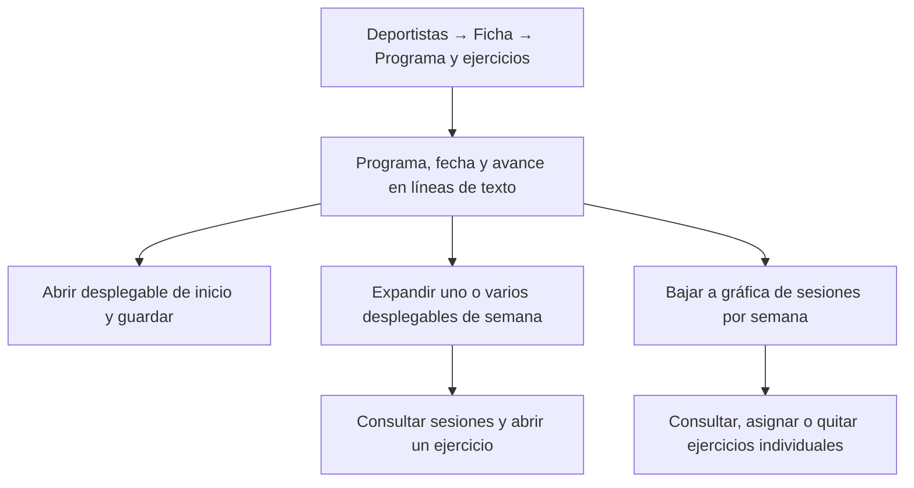
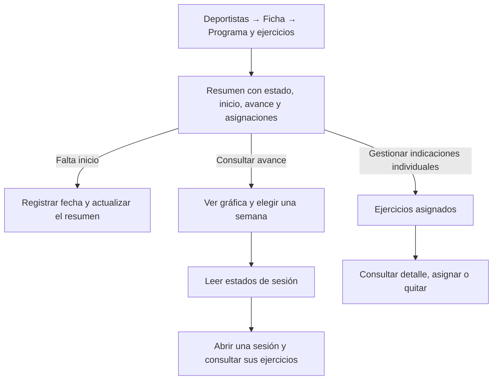

# Programa y ejercicios en la ficha del deportista

## 1. Objetivo del módulo

El fisioterapeuta consulta el avance del programa preventivo, registra cuándo comenzó la intervención y asigna ejercicios individuales. El programa organiza sesiones por semanas. Los ejercicios individuales se indican aparte y pueden llevar una dosificación y una nota específicas para el deportista.

## 2. Qué ve el usuario

| Rol | Consulta | Puede hacer |
| --- | --- | --- |
| Fisioterapeuta | Fecha de inicio, semanas, sesiones, ejercicios del programa y ejercicios individuales | Registrar o actualizar el inicio, abrir detalles, asignar y quitar ejercicios individuales |
| Entrenador | Los mismos datos para sus deportistas | Consultar semanas y abrir detalles |
| Deportista | Su propio plan y sus ejercicios individuales, desde su espacio | Abrir ejercicios y marcar o desmarcar sesiones de semanas disponibles |

La semana, la gráfica y las cifras de avance son informativas. La fecha, la asignación y el registro de sesiones son interacciones reservadas al rol correspondiente.

## 3. Estructura actual del módulo

Esta sección describe la interfaz previa al rediseño.

- **Programa preventivo.** Muestra el nombre, la duración, la frecuencia semanal, el inicio, la semana actual y el total registrado. Un desplegable abre el formulario de fecha. Cada semana tiene su propio desplegable con el número de sesiones completadas, la duración si existe, el estado y los botones de cada ejercicio. Estos abren el detalle compartido del ejercicio.
- **Sesiones por semana.** Repite los conteos semanales en una gráfica. La línea punteada marca la frecuencia objetivo configurada en el programa.
- **Ejercicios asignados.** Lista independiente, agrupada por componente. Cada fila abre el detalle. El fisioterapeuta puede abrir un formulario con el catálogo, cubrir dosificación y nota opcionales o quitar una asignación con confirmación. Las sugerencias se basan en coincidencias con zonas de molestias registradas.

## 4. Origen de datos

| Información | Fuente |
| --- | --- |
| Ficha, programa, avance y conteos semanales | `TeamAthleteApi.detail` consulta `GET /api/team/athletes/:id`. `routes/team.ts` usa `services/program.ts` para presentar el programa. |
| Fecha de inicio | `Athlete.programStartedAt`. El fisioterapeuta la guarda con `PATCH /api/team/athletes/:id/program-start`. Al guardar se actualizan la ficha y el dashboard mediante `TeamStore`. |
| Plan, orden y detalle de cada ejercicio | `Program`, `ProgramSession`, `SessionExercise` y `Exercise`. El servidor toma el primer programa con sesiones. Actualmente no hay selección de un programa distinto por deportista en la ficha. |
| Sesiones registradas | `CompletedSession` vincula al deportista con la sesión. `AthleteStore` carga `GET /api/program/current` y el deportista actualiza el registro con `POST /api/program/sessions/:id/toggle`. |
| Ejercicios individuales | `ExerciseApi` lee `GET /api/exercises/athlete/:id` o `GET /api/exercises/mine` en el espacio del deportista. Usa `GET /api/exercises` para el catálogo y `POST /api/exercises/assignments` y `DELETE /api/exercises/assignments/:id` para gestionar `ExerciseAssignment`. |

## 5. Estados del sistema

| Estado | Significado |
| --- | --- |
| Semana del programa | Bloque de siete días contado desde el inicio, con calendario de Bogotá. La primera semana empieza el día de inicio y el cálculo se detiene en el número de semanas del programa. |
| Sesión completada | Existe un registro del deportista para esa sesión. Es un registro de ejecución declarado por el deportista. La ficha muestra el estado y la duración planificada si existe. |
| Ejercicios asignados | El fisioterapeuta vinculó ejercicios al deportista. La dosificación de la asignación tiene prioridad sobre la del catálogo. Estas asignaciones se consultan por separado y quedan fuera del cálculo de adherencia. La interfaz no registra su cumplimiento individual. |
| Inicio de intervención | Fecha registrada por el fisioterapeuta, independiente del alta de la cuenta. El servidor evita que sea posterior al primer registro de sesión completada. El cambio conserva el historial. |
| Sin fecha o fecha futura | Todavía no hay semana activa ni sesiones previstas hasta hoy. El deportista debe esperar para marcar sesiones. Las completadas previamente siguen en el historial. Si la fecha es futura, el inicio ya está registrado. |
| Adherencia | El servidor divide las sesiones completadas en las semanas alcanzadas entre las sesiones previstas para esas semanas y redondea a porcentaje. Cuenta toda la semana actual. Sin sesiones previstas, la interfaz mejorada indica que aún no se puede calcular. |

La fecha, el contenido del plan, las asignaciones y las marcas de sesión provienen de la base. La semana actual, la adherencia y los conteos se derivan de esos datos.

## 6. Flujo actual del usuario

El fisioterapeuta abre **Deportistas**, entra a una ficha y selecciona **Programa y ejercicios**. Lee el resumen en texto, abre el formulario de inicio si lo necesita y expande cada semana que quiere consultar. Puede abrir un ejercicio de una sesión, bajar a la gráfica y después consultar o gestionar las asignaciones individuales.

## 7. Problemas detectados

- La fecha, el estado del programa y las sesiones completadas tienen casi el mismo peso visual. El pendiente de registrar el inicio queda junto a datos de consulta.
- Cada semana tiene un desplegable independiente. Al abrir varios se acumulan sesiones y botones de ejercicios. Los mismos conteos aparecen de nuevo en la gráfica.
- El formulario de inicio se abre con un control del navegador, mientras la acción de asignar usa el botón habitual del sistema.
- El resumen del programa y las asignaciones quedan alejados. La diferencia entre ejercicios pertenecientes a una sesión y ejercicios indicados por separado exige deducirla del contexto.
- «Sin iniciar» reúne dos casos que piden acciones distintas. Con fecha futura basta esperar, mientras que sin fecha el fisioterapeuta debe registrarla.

## 8. Propuesta de mejora

- **Resumen del programa** visible primero, con estado, inicio, semana, sesiones registradas, adherencia y cantidad de ejercicios asignados. Distinguir carga, error y cero asignaciones.
- **Inicio de intervención** dentro del resumen. Destacar **Registrar inicio** cuando falte la fecha. Usar **Editar fecha** como acción secundaria después de registrarla. Abrir el formulario solo al solicitarlo.
- **Progreso por semanas** con la gráfica existente y un selector único. Mostrar la semana actual por defecto, o la primera si todavía no hay semana activa.
- **Sesiones registradas** de la semana elegida. Mostrar el total, la duración disponible y el estado. Mantener un solo detalle de sesión abierto, con sus ejercicios y acceso al detalle del ejercicio.
- **Ejercicios asignados** en su propia tarjeta, con **Asignar ejercicio** para el fisioterapeuta. Mostrar la lista y conservar el formulario bajo demanda, los estados de carga, la agrupación y la confirmación al quitar.

## 9. Flujo propuesto del usuario

El fisioterapeuta entra al módulo y decide desde el resumen si debe registrar el inicio, consultar el avance o asignar ejercicios. Si necesita revisar sesiones, elige una semana y abre una sesión. Si necesita indicar un ejercicio individual, va a **Ejercicios asignados** y abre el formulario.

## 10. Diagramas de flujo Mermaid

### Flujo actual



### Flujo propuesto



## 11. Mapa visual

```text
Programa y ejercicios
┌─ Resumen del programa ──────────────────────────┐
│ Nombre · Estado                [Registrar inicio] │
│ Inicio     Semana     Sesiones registradas       │
│ Adherencia            Ejercicios asignados      │
│ Formulario de fecha visible al abrir la acción  │
└────────────────────────────────────────────────┘
┌─ Progreso por semanas ──────────────────────────┐
│ Gráfica semanal                                 │
│ Semana a consultar  [Semana actual ▾]           │
│ Sesiones registradas · Completadas / previstas  │
│ Sesión 1  Completada      [Ver ejercicios]      │
│ Sesión 2  Pendiente       [Ver ejercicios]      │
│ Ejercicios de una sesión, visibles al abrirla    │
└────────────────────────────────────────────────┘
┌─ Ejercicios asignados ─── [Asignar ejercicio] ──┐
│ Lista por componente o estado sin asignaciones │
│ Formulario visible al abrir la acción           │
└────────────────────────────────────────────────┘
```

En pantallas estrechas, las métricas y las acciones se ajustan en filas. Los bloques mantienen el mismo orden de lectura.
